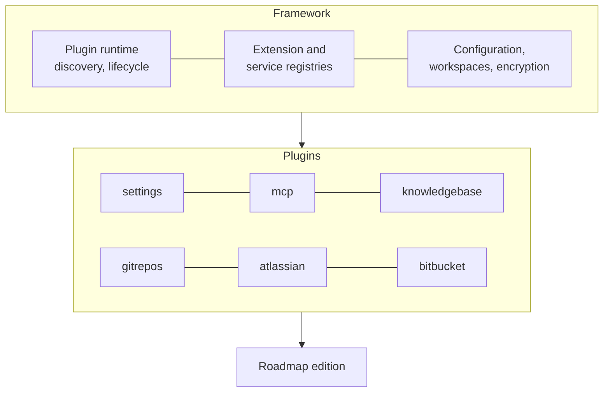

# Plugins

Roadmap is built on a **plugin framework**. Everything you use, from the Knowledge
Base to the MCP server and every information source, is a plugin; the framework underneath
discovers the installed plugins, starts them in the order their dependencies need,
and gives them a shared configuration, settings screens, encryption and workspaces.
An **edition** is the framework plus the plugins it bundles.

## The plugin model

- A **plugin** is a Python package the framework discovers at startup. It says which
  other plugins it requires, and the framework activates them in that order.
- A plugin can **declare extension points** and **contribute extensions** to points
  declared elsewhere. The flow runner, for example, declares the readers a flow can
  read its source with, and every plugin registers its tools on the MCP server.
- A few plugins are **core**: always on, and they can't be uninstalled. In Pro those
  are Settings, the MCP server and Users.
- The **frontend** mirrors this: each plugin adds its own pages, settings tabs and
  item types to the app.
- Plugins are **enabled per workspace**: one server serves several teams, each with
  its own configuration and data. See [Plugins per workspace](#plugins-per-workspace) for
  the screens that manage them.

## Plugins per edition

### Pro

Bundled: installed and enabled in every Pro install. The ids are the ones the
registry and *Settings → System → Admin* show.

| Plugin | What it adds |
|---|---|
| `roadmap.knowledgebase` | The Knowledge Base: the ground-truth graph (Layer 1), topics per persona (Layer 2) defined by topic types and [packs](../knowledge-base/packs.md), flows, orchestrations and branches; its page, its settings, and the `kb_*` MCP tools |
| `roadmap.knowledgebase.flows` | Runs Knowledge Base [flows](../knowledge-base/flows.md) on the server with your AI provider. Without it, flows are handed out as briefs for an external AI to carry out |
| `roadmap.mcp` | The MCP server, which every plugin registers its tools on: SSE at `/mcp/sse` and stateless HTTP at `/mcp` (see [The stateless endpoint](pro.md#the-stateless-endpoint)). Core |
| `roadmap.gitrepos` | [Git Repos](git.md): the repositories, each a name and a folder, and the checkout folders that say where they are on the server and on users' machines |
| `roadmap.atlassian` | The Jira and Confluence connection, under *Information Sources*, offered as a Layer 1 source. Jira issue and Confluence page nodes can be opened and refreshed through it, which pulls their title and an excerpt |
| `roadmap.bitbucket` | The Bitbucket connection, under *Information Sources*, offered as a Layer 1 source. Its nodes are pointers, as an agent or a flow wrote them |
| `roadmap.ai` | The AI providers |
| `roadmap.jobs` | Background jobs with a status and a log, such as flow runs, shown under *Settings → System → Jobs* |
| `roadmap.scheduler` | Scheduled tasks |
| `roadmap.settings` | The settings screens. Core |
| `roadmap.users` | [Users and roles](users.md): the root user, signing in, the *Users* and *Account* tabs, and API tokens. Core |

Roadmap doesn't sync or crawl any source: Layer 1 nodes are written by agents and
flows. Only Atlassian nodes can be opened and refreshed from Roadmap.

Extra: in the registry, installed from *Settings → System → Admin*.

| Plugin | What it adds |
|---|---|
| `roadmap.trello` | The Trello connection and its boards, under *Information Sources*, offered as a Layer 1 source. Its nodes are pointers, as an agent or a flow wrote them |

### Lite

To be released soon.

## Managing plugins

Managing plugins needs the admin role. A fresh install has every Pro plugin
installed and enabled. Optional plugins, such as Trello, install from the registry:

1. Go to *Settings → System → Admin* and select the plugin.
2. Click **Install**. Its badge changes to *Restart*.
3. Restart Roadmap: press Ctrl+C in its terminal, then start it again with
   `start.bat` or `bash start.sh`.

After the restart the plugin shows as *Installed* and is on in the workspace. Trello,
for example, then has its own tab under *Settings → Information Sources*, and the
Knowledge Base can use it as a source.

Three plugins are **core**: *Settings*, *MCP server* and *Users*. They are always
on, in every workspace, and can't be uninstalled; *Settings → System → Workspace* shows them as
*core · always on*.

### Plugins per workspace

Installing a plugin is for the whole server, but each [workspace](workspaces.md)
turns plugins on and off for itself. One workspace can use Trello while another
doesn't, for example. A plugin that is off in a workspace has no pages, settings tabs
or MCP tools there.

1. Switch to the workspace in the header.
2. Go to *Settings → System → Workspace*, titled *Plugins in workspace* and the
   workspace's name.
3. Turn plugins on or off, and click **Save & reload**.

Until you save that list for a workspace, every installed plugin is on in it,
including ones you install later. Once you have saved it, a newly installed plugin
starts off in that workspace: turn it on there. The core plugins are always on.

### The Admin and Workspace screens

Both screens work the same way:

- **Search** filters the plugins by name or id, and shows how many match.
- **List** and **Graph** switch between a list and a dependency graph. The graph
  asks before drawing more than 40 plugins, so narrow the search first.
- A plugin is marked **feature** when nothing depends on it, and **foundation** when
  it depends on nothing. Select one to see what it *depends on* and what it is
  *required by*.

Turning a plugin on in a workspace also turns on everything it depends on. Turning
one off also turns off everything that depends on it. A note names each plugin that
changed along with it.
