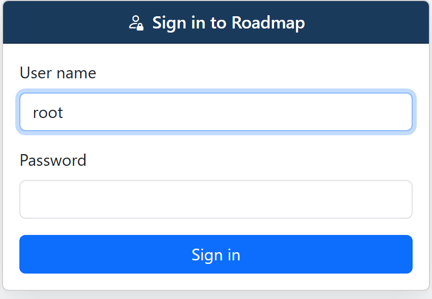
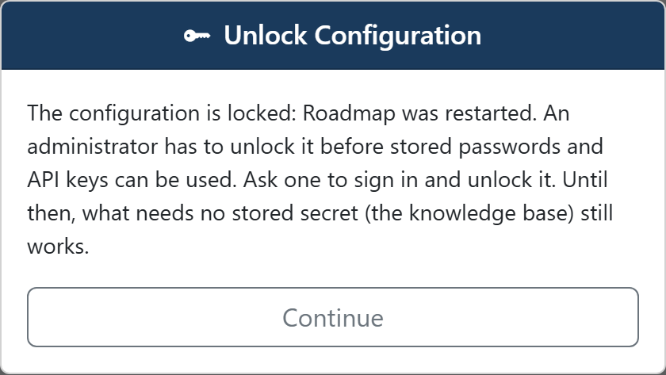

# Users and roles

Everyone who uses Roadmap signs in, and what they may do depends on their **role**.
The users are managed in Roadmap itself, under *Server administration → Users*.

## The root user

On the very first visit, before anything else, the browser shows **Create the root
user**:

1. **User name** is filled in with `root`; keep it or type another.
2. **Display name** is optional.
3. Enter a **Password** and enter it again under **Confirm password**. A password is
   at least 8 characters.
4. Click **Create and sign in**.

The root user is an admin who adds the other users, and it can't be removed or
demoted. Only after that does Roadmap ask for the encryption password (see
[Signing in is not unlocking](#signing-in-is-not-unlocking)).

Until the root user exists, Roadmap answers every other request with
`401 setup_required`.

## Signing in

From then on, every visit starts at **Sign in to Roadmap**: your user name and
password.

{ width="424" }

A session ends after 12 hours without use, when Roadmap restarts, and when an admin
resets your password or removes you. Then you sign in again.

After 5 wrong passwords in a row for one user name, signing in with that name pauses
for 60 seconds: *Too many wrong passwords for alice: try again in 42 seconds.*

## Where the settings are

Once you are signed in, the right of the header holds two menus:

- **Your name**: the user menu. It shows who is signed in and their role, and leads
  to **Personal settings**, your password and [API tokens](account.md), and to
  **Sign out**. Everyone has it.
- **Settings**, for admins only:
    - **Workspace settings**: the current workspace's configuration. AI providers,
      information sources and [Git Repos](git.md), the Knowledge Base, and under
      *System* the jobs, the scheduler and the workspace's
      [plugins](plugins.md#plugins-per-workspace). The menu shows which workspace
      that is.
    - **Server administration**: what holds for the whole server, the installed
      [plugins](plugins.md#managing-plugins) and the [users](#managing-users).

## Roles

A role holds on the whole server, in every workspace. Each role may do everything the
one above it may:

| Role | May |
|---|---|
| **Viewer** | Read: the Knowledge Base, the workspaces, the jobs, and their own account. |
| **Editor** | Also write data: Knowledge Base nodes and links, flow runs, branches. Also use [MCP](#mcp-needs-an-editor). |
| **Admin** | Also configure: the settings, plugins, workspaces (only admins see *+ New workspace…* in the header), users, and unlocking the configuration. In the Knowledge Base: personas and topic types, [packs](../knowledge-base/packs.md), orchestrations, and clearing a source. |

A viewer or an editor has no **Settings** menu, only *Personal settings* (see
[Where the settings are](#where-the-settings-are)).

The same rules hold over MCP. An editor's AI client can read and write the
Knowledge Base, but the `kb_admin` actions that change personas, topic types and
packs, or clear a source, and saving or deleting an orchestration, answer
`Not done: This needs the admin role; <user> is editor.`

### MCP needs an editor

An AI client connects with an API token, and acts as the user who made it, with
their role. MCP needs the editor role or higher. See
[Your account and API tokens](account.md).

## Managing users

*Server administration → Users* is for admins.

**Add a user**: click **Add user**, fill in a **User name**, a **Display name**, a
**Role** and a **Password**, and click **Add**. A user name is lower-case letters,
digits, `.`, `_` or `-`, starting with a letter or a digit, at most 64 long. Give the
user their password; they can change it under *Personal settings* (see
[Your account](account.md#change-your-password)).

In the list:

- **Role**: pick another role. It is stored at once. The root user's role can't be
  changed.
- **Set a new password** (the key button): type the new password and click **Set
  password**. If the user is signed in, they have to sign in again. Their API tokens
  keep working.
- **Remove** (the trash button): removes the user, signs them out, and their API
  tokens stop working. The root user has no Remove button.

The *API tokens* column shows how many tokens each user has.

## Signing in is not unlocking

Signing in says who you are. The **encryption password** is something else: it
encrypts the secrets Roadmap stores, such as AI keys and access tokens. On the first
start you choose it right after creating the root user, in the *Unlock
Configuration* dialog, under **Encryption password**. It is not your sign-in
password.

After every restart the configuration is locked again, and an admin unlocks it with
that password, unless `ROADMAP_KEY` is set (see
[Environment variables](pro.md#environment-variables)). A viewer or an editor who
signs in while it is locked is told that an admin has to unlock it, and can click
**Continue**.

{ width="420" }

While it is locked, the Knowledge Base works fully: reading, and for editors
writing, in the browser and over MCP. Only what reaches another system with a stored
secret waits for the unlock: refreshing a node from its source, and running a flow on
the server with your AI provider.

## Where users are kept

Users are kept in `users.yaml`, next to `config.yaml` (see
[Where your data lives](pro.md#where-your-data-lives)): user name, display name,
role, a hash of the password, and a hash of each API token. They belong to the
server, not to a workspace.

## A forgotten root password

If another admin can still sign in, they can set a new password for the root user
under *Server administration → Users*, like for anyone else. That also means any admin
can take over the root user: give the admin role only to people you would trust as
root.

If not, the last resort is to start over with the users:

1. Stop Roadmap.
2. Remove `users.yaml` from the folder that holds `config.yaml`.
3. Start Roadmap. The browser shows **Create the root user** again.
4. Create a new root user, then add the other users again. Everyone makes new API
   tokens, and every AI client is set up again with one.

!!! warning "This deletes every user and every token"
    Removing `users.yaml` removes all users and all their API tokens, not only the
    root user. It doesn't touch the configuration, the stored settings or the
    Knowledge Base, nor the encryption password: after the restart you unlock with
    that password as usual.

Anyone who can change files in that folder can do this. Keep access to it as
limited as access to `config.yaml`.

## When a request is refused

A request Roadmap refuses gets one of these answers. A `401` also carries a
`WWW-Authenticate: Bearer` header, so an AI client without a valid token reports an
authentication error:

| Status | Code | Means | What to do |
|---|---|---|---|
| 401 | `setup_required` | Roadmap has no users yet: create the root user first. | Open Roadmap in the browser and create the root user. |
| 401 | `login_required` | Sign in first (or send an API token). | In the browser, sign in. For an AI client, add a token, or replace one that was revoked or whose user was removed. |
| 429 | | Too many wrong passwords for alice: try again in 42 seconds. | Wait, then sign in with the right password. |
| 403 | `forbidden` | This needs the editor role; `alice` is viewer. | Ask an admin for a higher role, or use a token of a user who has it. |
