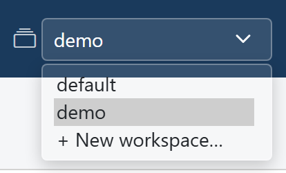
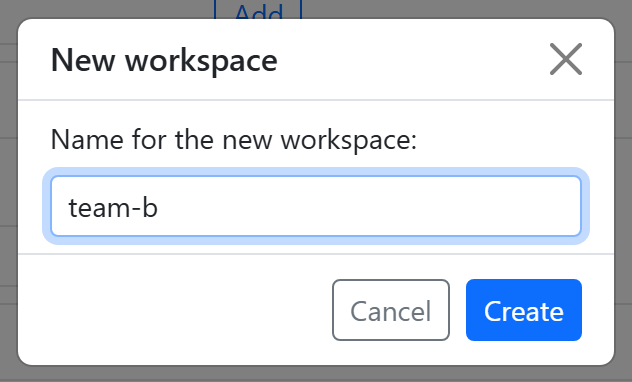

# Workspaces

One Roadmap server can serve several teams or projects, each in its own
**workspace**. A workspace has its own settings and its own data, and nothing is
shared between workspaces. Every install starts with one, `default`.

## What each workspace has of its own

- **Its settings**: everything under *Workspace settings*. Each workspace has its
  own AI providers, information sources
  (Jira and Confluence, Bitbucket, Trello), [Git Repos](git.md) and checkout folders,
  and Knowledge Base settings: personas, topic types, flows and orchestrations.
- **Its plugins**: which of the installed plugins are on (see
  [Plugins per workspace](plugins.md#plugins-per-workspace)).
- **Its data**: its own Knowledge Base.

So you can, for example, connect one workspace to one team's Jira and repositories,
and another workspace to another team's, each with personas of its own.

!!! tip "Teams that share their systems"
    Teams that work on the same repositories, pages and tickets don't need separate
    workspaces. Give each a [space](../knowledge-base/spaces.md) in one workspace
    instead: the sources are shared, each team has its own personas and work
    breakdown, and the teams can read each other's topics.

## What the whole server shares

- **Users and roles.** A user's role holds in every workspace (see
  [Users and roles](users.md)).
- **Installed plugins.** A plugin is installed once, for the server; each workspace
  turns it on or off.
- **Server administration**: the installed plugins and the users. *Workspace
  settings* shows the current workspace's name next to it in the Settings menu.
- **The encryption password.** One password unlocks the stored secrets of every
  workspace.

## Switching and creating workspaces

The workspace list is in the header, next to the workspace icon. Pick a workspace to
switch to it: the page reloads with that workspace's settings and data. The address
carries the workspace as `?ws=<name>`, so a link opens the same workspace.

{ width="207" }

To create one, an admin picks **+ New workspace…** at the bottom of the list, types a
name, and clicks **Create**. A name is letters, digits, `.`, `_` or `-`, starting
with a letter or a digit; upper case is turned into lower case, so `Team-A` becomes
`team-a`. `default` is taken. The new workspace starts
empty: configure its settings, Git Repos and Knowledge Base as for the first one, or
install a [pack](../knowledge-base/packs.md) in it.

{ width="316" }

A workspace can't be renamed or removed in the app.

## Where a workspace's files are

The `default` workspace uses `config.yaml` itself, by default `backend/config.yaml`
in the install folder. Any other workspace has its own folder,
`workspaces/<name>/`, next to it, with its own data, and its own `config.yaml` from
the first time its settings are saved (see
[Where your data lives](pro.md#where-your-data-lives)).

Which plugins are on in each workspace isn't in the workspace's own files: it is
kept for the whole server in `server.yaml`, next to the base `config.yaml`.

## Workspaces over MCP

An AI client works in one workspace per connection:

| Endpoint | Workspace |
|---|---|
| `/mcp/sse` and `/mcp` | `default` |
| `/mcp/<name>/sse` and `/mcp/<name>` | `<name>` |

For example, to connect Claude Code to a workspace called `team-a`:

```bash
claude mcp add-json -s user roadmap-team-a '{"type":"sse","url":"http://127.0.0.1:8090/mcp/team-a/sse","headers":{"Authorization":"Bearer <token>"}}'
```

Every tool also takes a `workspace` argument, which wins over the connection's, and
`list_workspaces` names them. A tool of a plugin that is off in the workspace answers
*Plugin '...' is not enabled in workspace '...', so this tool is unavailable there.*
