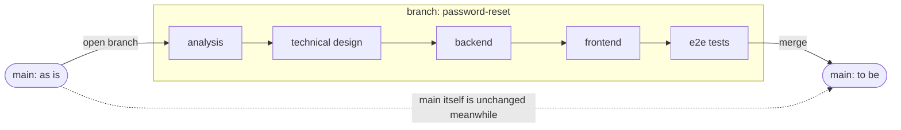
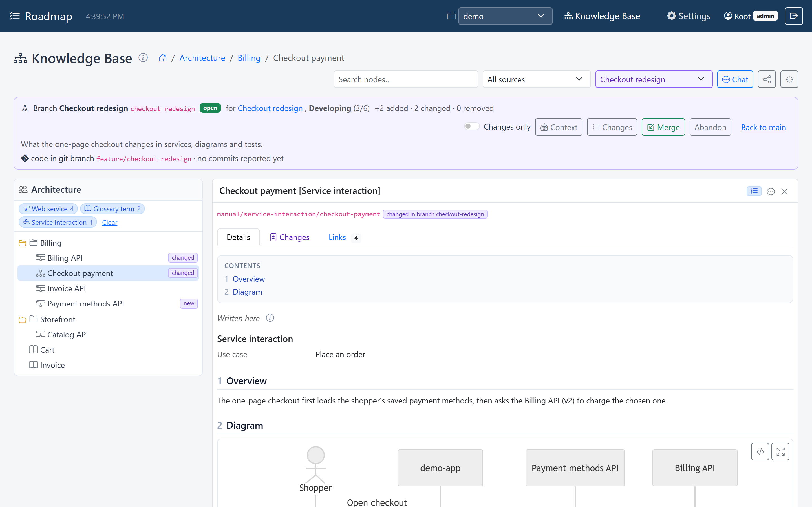
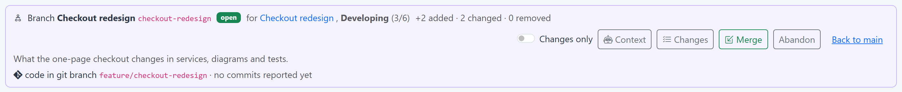
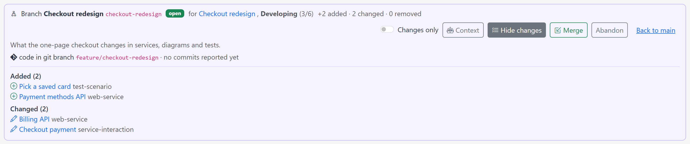
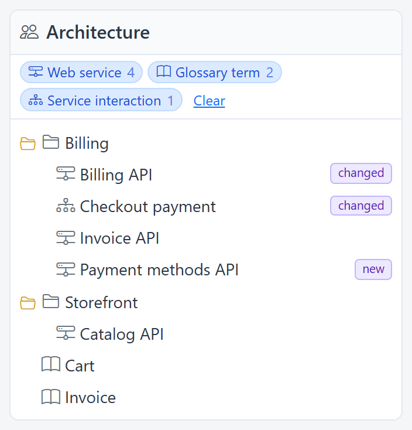
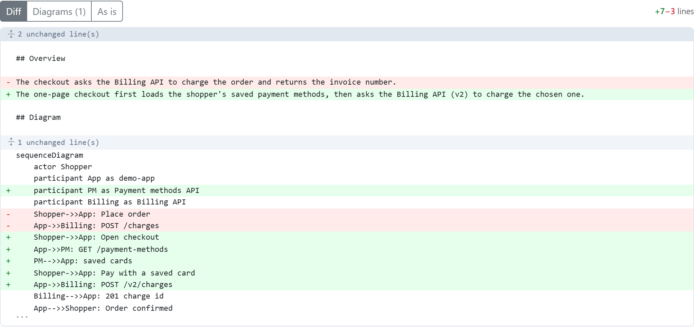
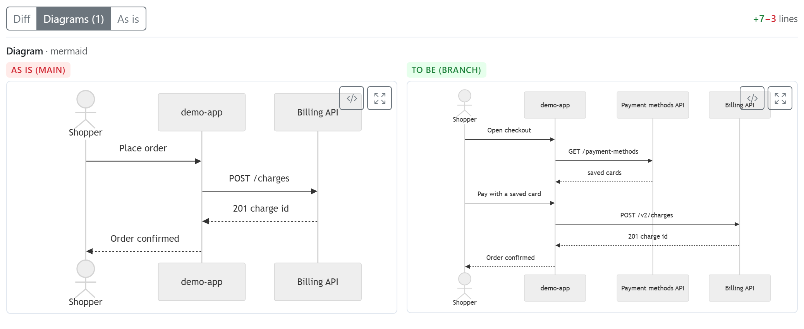
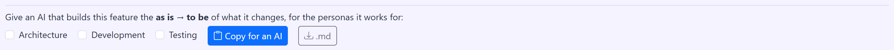

# Branches

The knowledge base describes the application **as it is**, built from the main
line of its code. A new feature is analysed, designed and built before it's part of
that, so what's written about it goes into a **branch**, the way new code goes into
a branch in git.



## How a branch behaves

- **Opened for one unit of work.** A branch belongs to a feature's work item, which
  stays on main: the work breakdown is shared, so the feature's progress shows on
  main while its content is in the branch.
- **Reading in a branch** sees main plus the branch: what it added is there, what it
  changed reads as changed, what it removed is gone. Each node says whether the
  branch `added` or `changed` it. **Main** sees none of it.
- **Writing in a branch** is copy on write: the first change to a node from main
  copies it into the branch. A delete in a branch hides the node there and leaves
  main alone.
- **Merging** applies the branch to main in one step. It's refused while the work
  item isn't in its last state, and while main changed a node the branch changed
  too. *Merge anyway* lets the branch's version win.
- **Abandoning** closes a branch without merging. It stays readable and can be
  reopened.

## Branches and git

A branch can name the **git branch** the feature's code is built in. Each commit
on it marks a step of the work (backend done, frontend done) and is recorded on the
knowledge-base branch. The rule that ties them together:

> Merge the code into the main line first. Only then merge the knowledge-base
> branch, so the knowledge base never describes code that main doesn't have.

An [orchestration](orchestration.md) can enforce this, with a release step that
merges the git branch, followed by a `merge_branch` state.

## Seeing the delta

In the explorer, the **branch picker** in the header switches the whole page to a
branch (it's in the URL as `?branch=`). A bar then shows the branch, its work item
and state, its git branch and last commit, and what it changes, with **Changes**,
**Merge**, **Abandon** and **Back to main**. The trees mark nodes *new* or *changed*.



{ width="1408" }

**Changes** lists what the branch added and changed:

{ width="1408" }

{ width="352" }

- **Changes only** narrows the lanes and the graph to what the branch adds or
  changes, plus the folders above them so the trees still read.
- A new or changed topic gets a **Changes** tab:
    - *Diff*: the topic as text, line by line, as is → to be, with long unchanged
      stretches folded;
    - *Diagrams*: every diagram or screen sketch that changed, drawn as is and to be
      side by side;
    - *As is*: the topic as main has it.

{ width="1022" }

{ width="1038" }

## Context for the developer

A branch's analysis and design are exactly what a developer agent needs to build
the feature, so a branch can hand over its **context**: the branch as
**as is → to be**. Every topic it adds is shown in full, every topic it changes as
a diff against main, every topic it removes is listed, all grouped by persona.

In the explorer, **Context** lets you pick the personas a developer works for (a
backend developer: analysis, design, backend) and copy the instruction for the AI,

{ width="1382" }

or download the markdown. Over MCP:

```
kb_branch("context", id="password-reset", personas="analysis,architecture,backend")
```

A flow brief opened in a branch points to it as well.

## Over MCP

`kb_read`, `kb_write` and `kb_flow` take an optional `branch` argument, and the
`kb_branch` tool manages branches. A
[chat](chat.md) can be put on a branch too.
