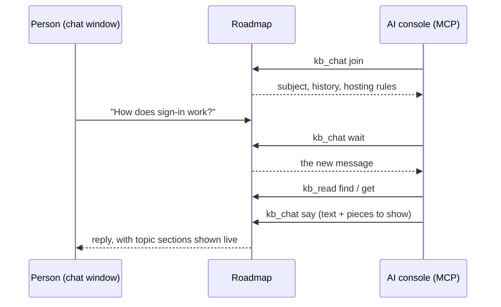

# Chat

A person can **chat about the knowledge base** with an AI that isn't Roadmap's own.
The explorer's **Chat** button (about the whole knowledge base), or the chat icon
on a selected node (*chat about this*), opens a chat window in a new tab. Roadmap
doesn't answer. Instead, the window's **MCP** button copies an instruction to paste
into an AI console connected to Roadmap's MCP server, such as a Claude Code
terminal:

```
Use roadmap MCP to host knowledge-base chat kbc-x7k2qa in workspace "my-team":
kb_chat("join", id="kbc-x7k2qa", workspace="my-team") and follow what it says,
then loop kb_chat("wait") / kb_chat("say") until the person is done.
```



## How the AI hosts it

`join` gives the AI the hosting rules:

- the person drives; replies are short and end with where to go next;
- for someone new, a very short overview first, then let them explore;
- **show, don't paste**: put small pieces in the window (a section of a topic, a
  diagram or a screen sketch), at most four per reply;
- say so when the knowledge base doesn't hold the answer.

A piece shown in the window is read live from the knowledge base, with a link that
opens it in the explorer.

## Robust by design

Nothing is long-lived. The window polls for new messages every 1.5 seconds and the
AI's `wait` returns after a few seconds, so reloading either side breaks nothing.
The window shows whether an AI is connected and a typing indicator while it works.
A closed chat can be **reopened**, and the AI joins again.

## On a branch

A chat can be on a [branch](branches.md). The window shows a *branch* badge that
opens the explorer in that branch, the AI is told to read in it, and every piece it
shows remembers the branch it came from. A chat opened from the explorer while it
shows a branch starts on that branch.
