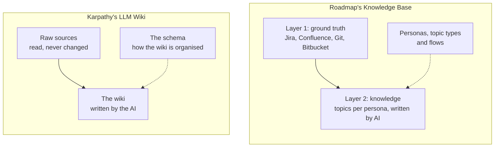

# Concepts

The Knowledge Base starts from one observation: an AI that works on your software
needs to know what your teams already know, and that knowledge is scattered over
tickets, wiki pages and code, written for other purposes and never in one place.
Searching all of it again for every question is slow, and the answer is only as
good as the search.

## The idea: let the AI keep a wiki

In April 2026 Andrej Karpathy described the
[LLM Wiki](https://gist.github.com/karpathy/442a6bf555914893e9891c11519de94f): instead
of letting an AI search raw documents every time, let it **write and maintain a
wiki** from them. The raw sources stay as they are; the AI reads them and builds
interlinked pages, keeps them up to date as sources change, and answers questions
from the wiki. A short set of conventions, the schema, tells the AI how the wiki is
organised.

Roadmap's Knowledge Base is that idea for a team building business software:

| LLM Wiki | Roadmap |
|---|---|
| Raw sources | **Layer 1**, the ground truth: what your systems already hold |
| The wiki | **Layer 2**, the knowledge: [topics](topics.md) written by AI agents |
| The schema | [personas](personas.md), topic types and [flows](flows.md), set up in Roadmap |
| Ingest, query, lint | flows write the knowledge; AI clients and people read it; branches and runs keep it honest |

## Layer 1: the ground truth

Layer 1 is what your teams already wrote: Jira issues, Confluence pages, Git
repositories, Bitbucket. Roadmap doesn't copy it. A Layer 1 node is a **pointer**:
it says which system holds the item and under what id, and the content is read
from that system when someone looks at it. So Layer 1 can't go stale, and nothing
in it can be made up along the way.

Layer 1 is deliberately not interpreted. It keeps the shape of what your teams
wrote, so every claim Layer 2 makes can point back at where it came from.

## Layer 2: the knowledge

Layer 2 is what an AI writes from Layer 1: **topics**, such as a use case, a web
service, a database, a test scenario or a sequence diagram. Two ideas set it apart
from a plain wiki.

- **Written for someone.** Every topic is written for a [persona](personas.md): a
  role or a specialism, such as an architect, a tester or a business analyst. An
  architect and a business analyst need different pages out of the same ticket, so
  each persona gets its own lane of topics.
- **Written to a specification.** Every topic has a type, and the type says what a
  topic of it holds: the fields to fill in, or the headings to write under. The
  tenth test scenario has the same shape as the first, so topics can be compared,
  and an AI knows exactly what to write (see [Topics](topics.md)).

Where no other system is the system of record, for a test scenario or a use case
for example, the topic itself is the record: the Knowledge Base owns it.

## Keeping it right

A wiki that an AI writes needs to stay trustworthy:

- **Every write is traced.** An AI writes through a [flow](flows.md), and every
  topic it writes remembers which flow, which prompt and which run wrote it. A run
  can be undone.
- **Work in progress stays apart.** What's written about a feature that isn't built
  yet goes into a [branch](branches.md), and only joins the main knowledge once the
  code has the feature.
- **People stay in charge.** People read the knowledge in the
  [explorer](explorer.md), and decide what is wrong: deleting a topic is a human
  call.

## The work breakdown

Next to the personas' lanes, the Knowledge Base holds the **work breakdown**: the
project, its features and their steps, each with its state and progress. It belongs
to no one persona, because it cuts across all of them. Topics written while working
on a feature are linked to it, so "what do we know about this feature?" has an
answer, and [orchestrations](orchestration.md) move features through their states
as the work goes on.

## Workspaces and spaces

Each [workspace](../get-started/workspaces.md) has its own Knowledge Base. Nothing
is shared between workspaces.

Inside a workspace, each team or project can have a [space](spaces.md) of its own:
its own personas, topic types, work breakdown, flows and topics. The ground layer is
shared by every space, and a space can read the others' topics.
