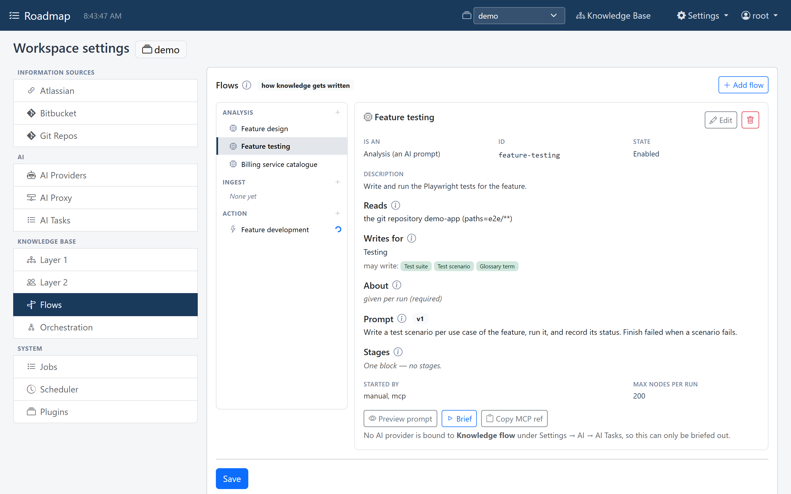
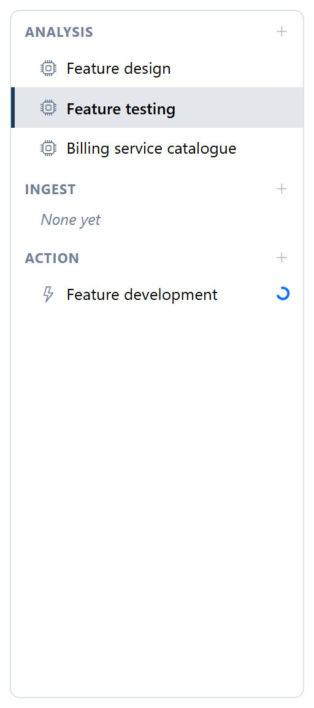
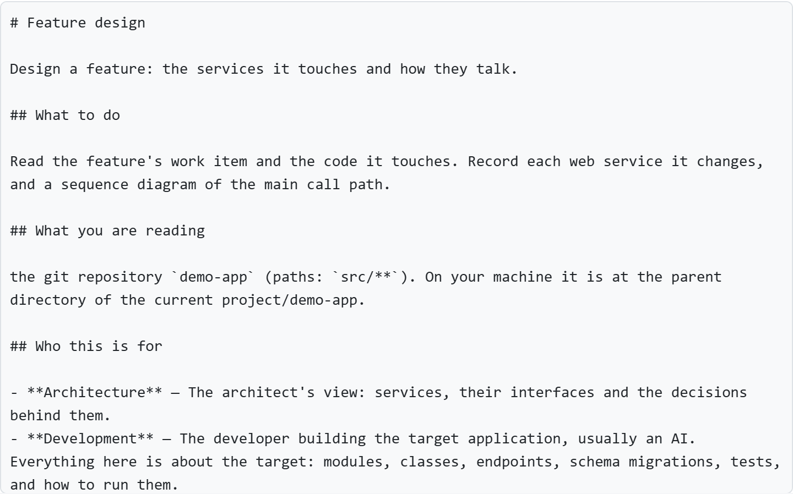
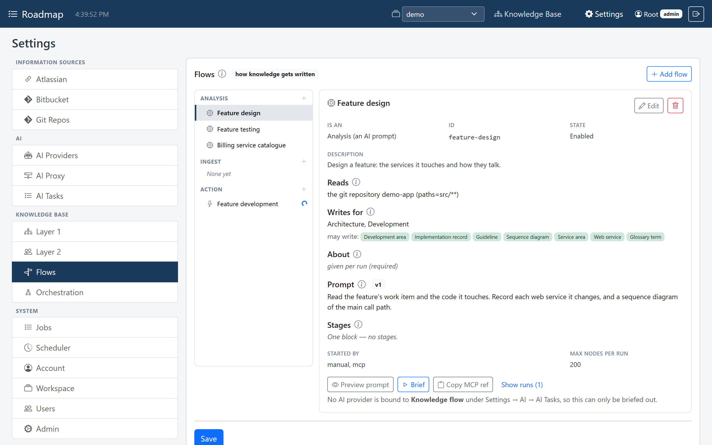
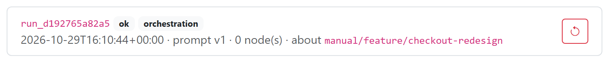

# Flows

A **flow** is a configured path into the knowledge base: what gets read, who it's
written for, and what produces it. The list of flows answers the question "what
writes in here, and when?"

| Kind | What produces it | Needs |
|---|---|---|
| `analyse` | an AI, from a prompt, reading a source | instructions, target personas, a source |
| `ingest` | an adapter, copying a source into the ground layer | a source |
| `act` | an AI that *does* something outside the knowledge base: builds, runs tests, merges | instructions only; its outcome is what counts |

Flows are configured under *Workspace settings → Knowledge Base → Flows*, or written over
MCP.



The list groups the flows by kind, and a spinner marks one with a run in progress:

{ width="256" }

```yaml
- id: step-development
  name: Step development
  kind: analyse
  source: {kind: repo, ref: my-app}      # repo | kb_source | web, and context where Contexts is installed
  targets:
    personas: [backend, frontend]
    node_types: []                       # empty = every type of those personas
  work_item: {kind: feature, required: true}
  prompt:
    instructions: "Implement the step described in the context, then document ..."
    stages:
      - {id: read, label: Read the context}
      - {id: build, label: Build the backend}
  triggers: [manual, mcp]
```

## The prompt is mostly generated

Only `instructions` is written by a person. Everything else in the prompt is
generated: the personas, a full description of every topic type in scope (its
fields or its template), where the result goes, and how to write it back. An
output contract that someone can edit by hand is one that breaks without anyone
noticing. **Preview** on the Flows tab shows the whole prompt.

{ width="720" }

An empty `targets.node_types` means every type of the target personas plus the
shared ones, so a type added for a persona is usable by its flows right away.

## Three ways to start one

| | What happens | Needs |
|---|---|---|
| **Brief** | the prompt is handed to an AI you already have, which carries it out over MCP | nothing |
| **Run here** | Roadmap reads the source, asks its own AI provider, and writes the answer as a background job | the `knowledgebase.flows` plugin and a provider |
| **Source trigger** | a scheduled scan starts the flow when its source has moved (a new commit) | the above, plus the scheduler |

The brief is the cheap path and the reason it exists. The costly half of an
analysis is the thinking, and an AI already connected over MCP is already paid for.

With no AI provider bound to the flow runner, the Flows tab says so, and a flow
can only be briefed out:



An AI that takes a flow on gets its brief, reports each stage as it starts it,
writes what it found, and finishes the run with how it went.

## Runs and provenance

A **run** exists from the moment a flow is handed out. That puts work done by an
outside AI in the same history as everything else, and it gives the nodes a run id
to carry.

**Show runs** on a flow lists them:

{ width="736" }

Every node written under a run carries a `provenance` stamp in its details:

```json
"provenance": {
  "flow": "delphi-tip-analysis", "flow_version": 1, "prompt_version": 1,
  "run": "run_c2ccdabacad1",
  "trigger": {"mode": "mcp", "tool": "kb_flow"},
  "source_position": "9af336c8a5c2...",
  "model": "claude-opus-5", "at": "2026-10-11T09:15:02+00:00"
}
```

The stamp is applied on the server and overwrites whatever the writer sent:
provenance that a writer could forge would be worthless. It lets you ask "which
topics came from the old prompt?" after improving it.

A run can be **undone**, which makes writing straight into the graph safe without
a staging area. Undo works per node: a node the run created is deleted, a node it
changed is put back as it was (the first change keeps the old version), and the
links it made are removed.

## Stages and progress

A run can take an hour. To show what it's doing without tracing every call, a flow
can declare **stages**: the few large blocks it goes through (*Read the context*,
*Build the backend*, *Run the whole suite*). The worker reports each one as it
starts it, and the reports show on the run and on the unit of work's *Progress* tab.

## Outcomes

Only the worker knows whether the work reached its goal, so a run ends with an
**outcome**:

| Status | Means | The work item |
|---|---|---|
| `ok` | the work reached its goal | moves to the flow's `on_finish` state |
| `failed` | the work was done and didn't reach it: a test fails, a build breaks | moves to `on_fail`, with the message in its log |
| `error` | the run itself broke (the provider failed) | stays where it is |
| `undone` | the run was taken back | stays where it is |

A `failed` run needs a message, because it's what the next run starts from. Moving
work on from an outcome is usually the job of an [orchestration](orchestration.md).
