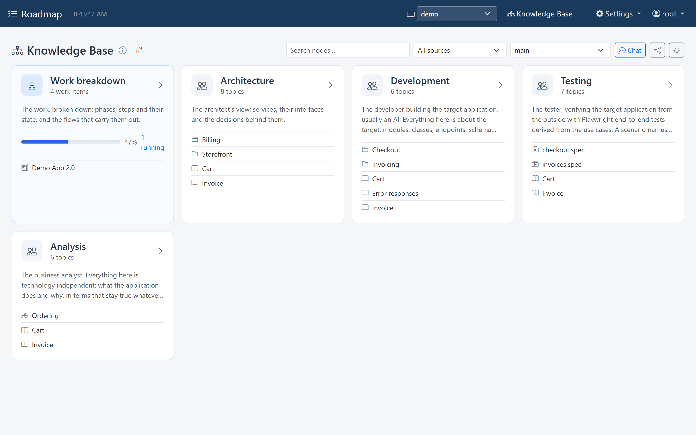

# Pro edition

Pro is the **Knowledge Base**: an organisation-wide store of what your teams know
about their systems, written by AI agents from what your teams already have in Jira,
Confluence, Git and Bitbucket. People read it in the [explorer](explorer.md), and AI
clients read and write it over [MCP](../get-started/pro.md#connect-an-ai-client).

!!! note "Status"
    The Knowledge Base is a working prototype. Topics, flows, orchestrations,
    branches and chat all work today. Reading Jira and Confluence into Layer 1 on a
    schedule is the next step; until then, Layer 1 is written by agents and by hand.

## Where to go next

- [Concepts](concepts.md): the idea behind it, Layer 1 and Layer 2.
- [Personas](personas.md): who the knowledge is written for, and setting them up.
- [Topics](topics.md): the pages of knowledge, and the types that shape them.
- [Packs](packs.md): ready-made personas and topic types to install.
- [The explorer](explorer.md): finding your way through the knowledge.
- [Flows](flows.md): how knowledge gets in, and how every write is traced.
- [Orchestration](orchestration.md): taking a feature through design, development
  and testing.
- [Branches](branches.md): knowledge about work in progress.
- [Chat](chat.md): talk about the knowledge base with an AI.
- [Scenario: implement a simple use case](walkthrough.md): all of it together, on
  one feature.
