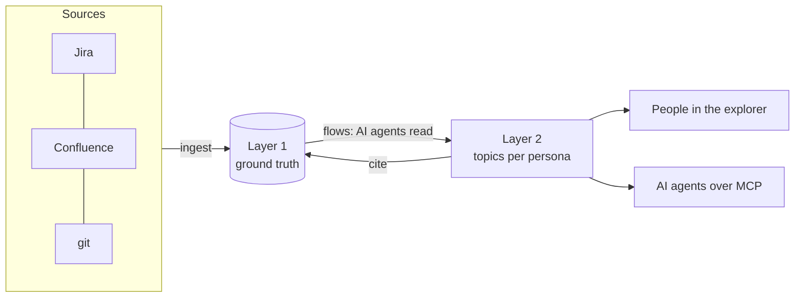

# The Knowledge Base

The Knowledge Base is Roadmap's AI-backed, organisation-wide store of what a team
knows about its systems. It's a graph that AI agents read and write over
[MCP](../reference/mcp-tools.md), and that people browse in the
[explorer](explorer.md).

!!! note "Status"
    The Knowledge Base is a working prototype. The graph, the API, the MCP tools,
    flows, orchestrations, branches and chat all work today. Automatic ingestion
    adapters (filling the ground layer from Jira or Confluence on a schedule) are the
    next phase; until then the graph is written by agents and by hand.

## Two layers

| | What it holds | Who writes it |
|---|---|---|
| **Layer 1: ground truth** | A graph of **nodes** (a ticket, a wiki page, a commit, a file) and the **links** between them, from the information sources the installation already has | Ingestion, on a schedule or a webhook |
| **Layer 2: knowledge** | **Topics**: one tree per **persona**, cross-referencing each other and citing layer 1 | AI agents, carrying out [flows](flows.md) |

Layer 1 is deliberately *not* interpreted. It keeps the shape of what your teams
wrote, so every claim layer 2 makes can point back at a node. Layer 2 makes the
material useful to a *person*: an architect and a business analyst need different
pages out of the same ticket.

## A node is a pointer, not a copy

The ground layer is built around one rule. A node stores **identity** (the source,
the kind, the id the owning system uses) and nothing else. The content is fetched
from that system when someone looks at it:

- the graph can't drift from the system of record, because it holds no copy that
  could go out of date;
- an agent doesn't have to *read* a ticket to record it, so it can't paste in a
  summary it made up along the way;
- permissions and edits stay where they belong: in Jira, in Confluence, in git.

## ...unless the Knowledge Base owns it

A database, a web service, a test scenario, a use case: no other system is the
system of record for these, so the Knowledge Base is. These are **content nodes**.
A content node's `kind` is a configured [node type](concepts.md#node-types), so it
carries its content instead of fetching it.

One rule keeps the two shapes apart: a node of a configured type may carry
content, and a node of any other kind may not. So "pointer or content" is never a
judgement call when writing. It follows from whether the kind is a type.

## One knowledge base per workspace

Roadmap serves several **workspaces** (tenants) from one server, and each one has
its own knowledge base: its own personas, node types, flows and orchestrations
(in that workspace's configuration), and its own graph (in its own SQLite file).
Nothing is shared between workspaces. Every MCP tool takes an optional
`workspace` argument; the web app carries the workspace in its URL (`?ws=`).

## Where to go next

- [Concepts](concepts.md): personas, node types, the work breakdown, relations.
- [Setting up personas and node types](setup.md): the first thing to do in a new
  Knowledge Base.
- [Packs](packs.md): ready-made personas and node types to install.
- [The document format](documents.md): how a topic's text, diagrams and screen
  sketches are written.
- [Flows](flows.md): how knowledge gets in, and how every write is traced.
- [Orchestration](orchestration.md): state machines that run flows.
- [Branches](branches.md): knowledge about work in progress.
- [Chat](chat.md): talk about the knowledge base with an AI.
