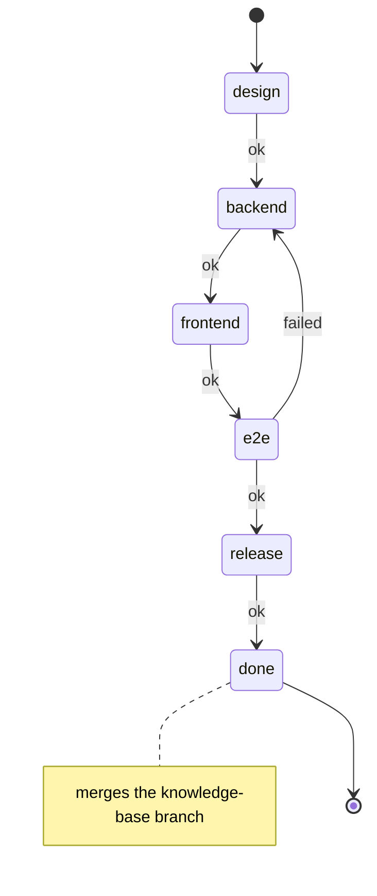
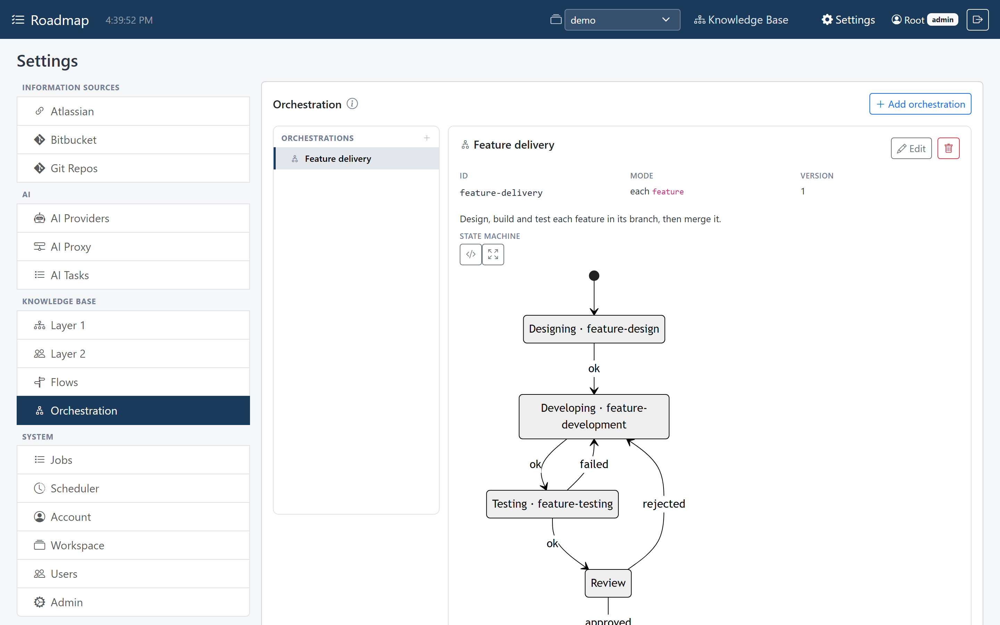
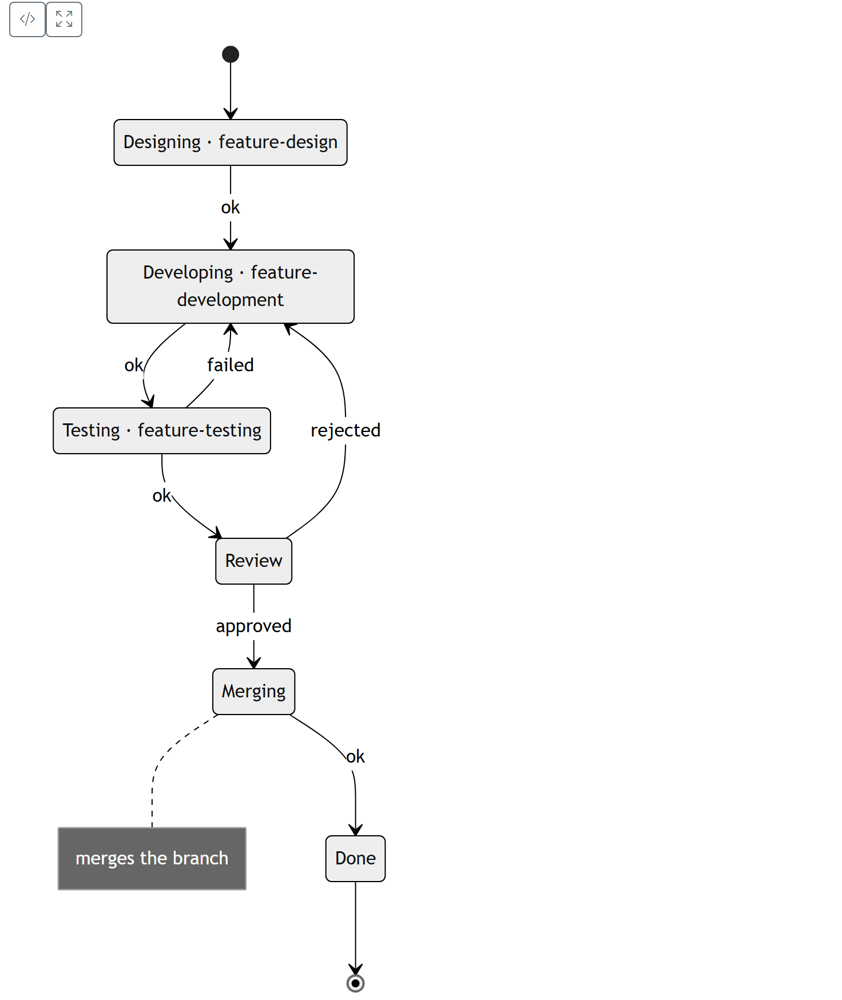
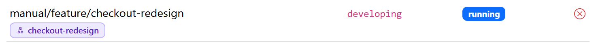

# Orchestration

A flow only says how its work went. **What happens next** is an orchestration's
job: a state machine, configured per workspace, driven by the outcomes of the runs
it hands out. "Testing failed, back to development" is a transition in an
orchestration, not a field on the testing flow.

```yaml
orchestrations:
  - id: feature-delivery
    mode: each                  # single: once | each: per unit of work
    subject_type: feature       # each: the work type whose items get an instance
    initial: design
    max_visits: 5               # entering one state more often than this = stuck
    states:
      - {id: design,    flow: technical-design}
      - {id: backend,   flow: backend-development}
      - {id: frontend,  flow: frontend-development}
      - {id: e2e,       flow: e2e-testing}
      - {id: release,   flow: merge-git-branch}     # an `act` flow
      - {id: done,      final: true, merge_branch: true}
    transitions:
      - {state: design,   on: ok,     to: backend}
      - {state: backend,  on: ok,     to: frontend}
      - {state: frontend, on: ok,     to: e2e}
      - {state: e2e,      on: ok,     to: release}
      - {state: e2e,      on: failed, to: backend}
      - {state: release,  on: ok,     to: done}
```



Entering `done` first moves the feature's work item to its own `done` state, and
then merges the branch. A merge is refused while the work item isn't finished, so
the final state is the natural place for it.

| Piece | Means |
|---|---|
| state with a `flow` | work: entering it makes the flow's run **ready**; the run's outcome is the signal that leaves it |
| state without one | **waiting** for a signal from a person or an agent (`approved`, or any word) |
| `final` state | the instance is **done** |
| `merge_branch` state | entering it merges the instance's [branch](branches.md) into main; a refused merge leaves the instance stuck with the reason. It can't have a flow of its own |
| transition | in `state` (`*` for any), on signal `on`, go to `to` |
| no matching transition | `error` stays in the state, ready to retry; any other signal leaves the instance **stuck** |

## Instances

An **instance** is one walk through the machine. `single` makes one for the
project; `each` makes one per unit of work of `subject_type` (starting again picks
up items added since). Its status is `ready`, `running`, `waiting`, `done`, `stuck`
or `cancelled`.

Entering a state also moves the instance's unit of work to the state with the same
id, when its type has one, so the work breakdown shows where each item is. When
the work type is missing some of the machine's states, saving or starting the
orchestration says so.

## The worker loop

An AI connected over MCP works through an orchestration like this:

1. `kb_orchestrate("start", id=...)` creates the instances in the initial state.
2. `kb_orchestrate("next")` opens the run for the oldest ready instance and returns
   an ordinary [flow brief](flows.md), ending with a note on what each outcome
   leads to.
3. The AI does the work, writes with `kb_write(..., run=...)`, then calls
   `kb_flow("finish", outcome="ok" | "failed")`. The outcome moves the instance on.
4. `next` again, until nothing is ready.

## In a branch

An instance works **in a [branch](branches.md)**: the open branch of its unit of
work when it's started, unless `start` names another (`main` forces main). Its
runs are briefed in that branch, and when the branch names a git branch, the brief
says to work and commit there and to report the commit when finishing.

A feature's delivery is then one machine: design, backend, frontend, end-to-end
tests (`failed` back to development), a step that merges the code into the main
line, and a final `merge_branch` state. The knowledge base takes the feature's
topics only once the code has the feature.

The Orchestration settings tab draws each machine as a diagram and lists its
instances.



{ width="736" }

Below the diagram are the instances, each with its unit of work, its state, its
status and its branch:

{ width="736" }
