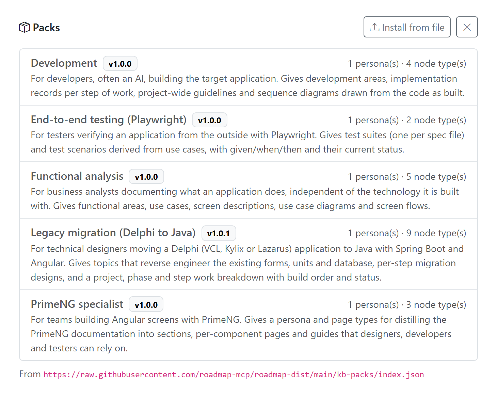
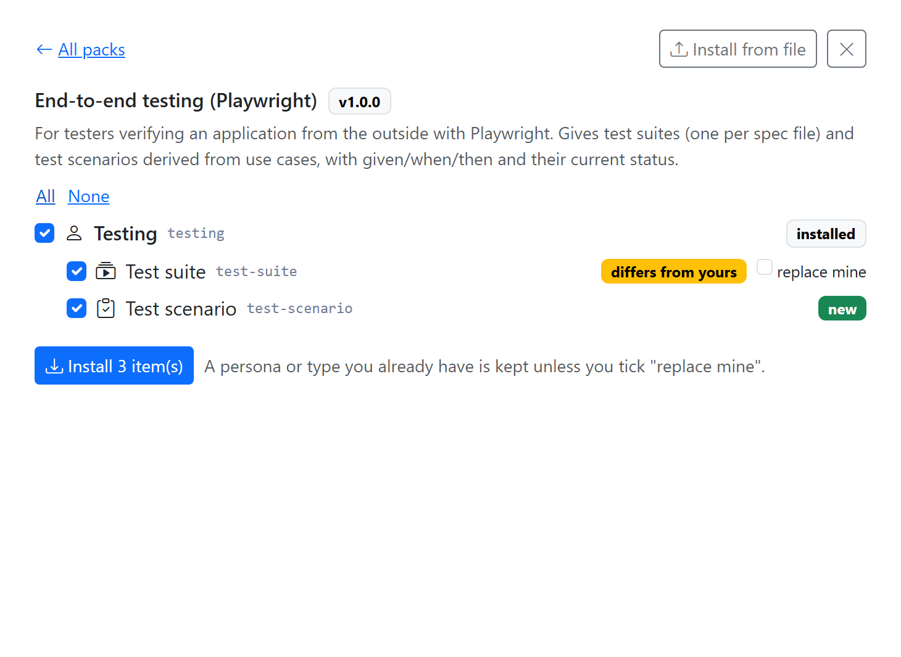
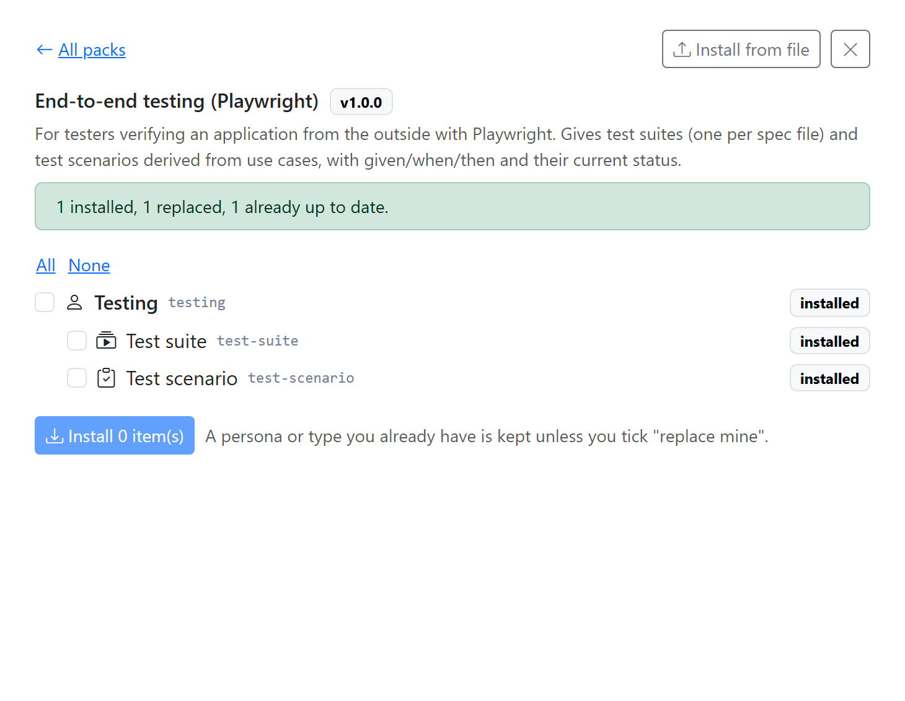
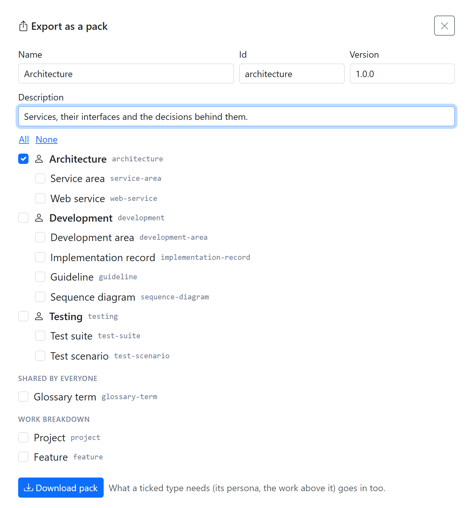

# Installing packs

A **pack** is a ready-made set of [personas](personas.md), the
[topic types](topics.md#topic-types) written for them, and the types of work that go
with them. Install one instead of setting everything up yourself, then adapt what it
gives you: a persona or topic type from a pack is changed and removed like any other
(see [Set up personas](personas.md#set-up-personas) and
[Add a topic type](topics.md#add-a-topic-type)).

Packs are published in a **pack registry**, the way plugins are in the plugin
registry. Installing one only adds personas and types to the configuration; it
doesn't install any code. Installing a pack needs the
[admin role](../get-started/users.md#roles). A pack is installed into the
[space](spaces.md) you are in: a new space, like a new
[workspace](../get-started/workspaces.md), starts empty.

## The packs

| Pack | Persona | What it holds |
|---|---|---|
| `functional-analysis` *Functional analysis* | Analysis | functional areas, use cases, screen descriptions, use case diagrams, screen flows |
| `legacy-migration` *Legacy migration (Delphi to Java)* | Technical design | reverse-engineering topics (screens, units, database) and migration designs, plus a work breakdown of migration project, phase and step, with a seven-state lifecycle for a step |
| `development` *Development* | Development | development areas, implementation records, guidelines, sequence diagrams |
| `e2e-testing` *End-to-end testing (Playwright)* | Testing | test suites and test scenarios |
| `primeng-specialist` *PrimeNG specialist* | PrimeNG specialist | sections, components, guides |

## Install a pack in the settings screen

1. Go to *Workspace settings → Knowledge Base → Layer 2* and click **Packs**. The registry's
   packs are listed, each with its version, description and how many personas and
   types it holds.

    { width="730" }

2. Open a pack. Every persona and type in it has a checkbox, and a state:
    - **new**: you don't have it yet;
    - **installed**: you have it, the same as in the pack;
    - **differs from yours**: you have one with the same id, but it isn't the same.

    { width="730" }

3. Tick what you want. The whole pack is ticked to start with; **All** and **None**
   tick or untick everything. Ticking a type also ticks what it needs: its persona
   and the work types above it. Unticking a persona or a work type unticks what
   depends on it.
4. Click **Install N item(s)**. The result says what happened, such as *2 installed*
   or *1 kept as you had them*, and the ticks are cleared.

    { width="730" }

A persona or type you already have is kept as you have it, unless you tick
**replace mine** on it. A replaced persona keeps its place in the order of the lanes.

**Install from file** installs a pack file from your disk the same way: it shows the
same list and states. A file that isn't a valid pack is refused with the reason, for
example a type written for a persona the pack doesn't carry.

## Export your own pack

**Export**, in the Layer 2 header, writes personas and types you have as a pack:

1. Fill in a **Name**, an **Id** (filled in from the name), a **Version** and a
   **Description**.
2. Tick the personas and types to include. What a ticked type needs, its persona
   and the work types above it, goes in too.
3. Click **Download pack**. You get `<id>.json`.

    { width="730" }

Install it in another space or workspace with **Install from file**, or share it.

## Another pack registry

The app reads the registry at
`https://raw.githubusercontent.com/roadmap-mcp/roadmap-dist/main/kb-packs/index.json`.
To use another one, set `ROADMAP_KB_PACK_REGISTRY_URL` before you start Roadmap (see
[Environment variables](../get-started/pro.md#environment-variables)).
