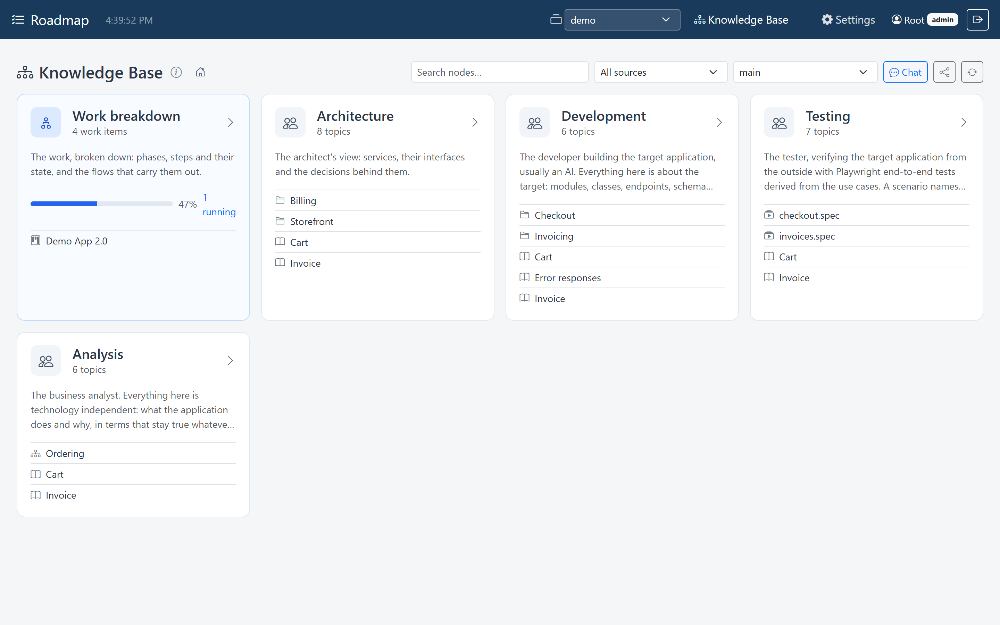
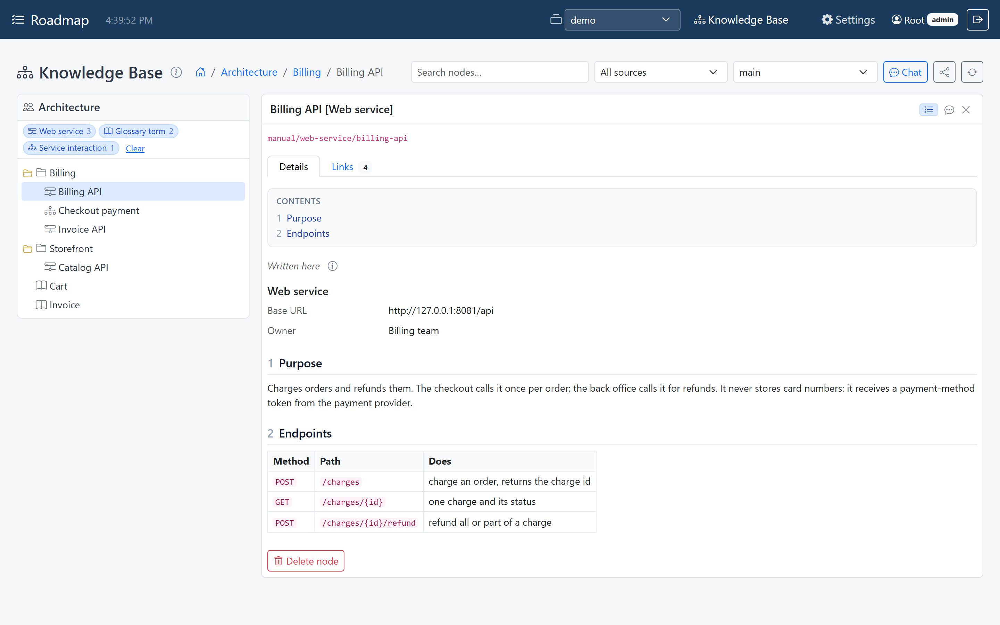
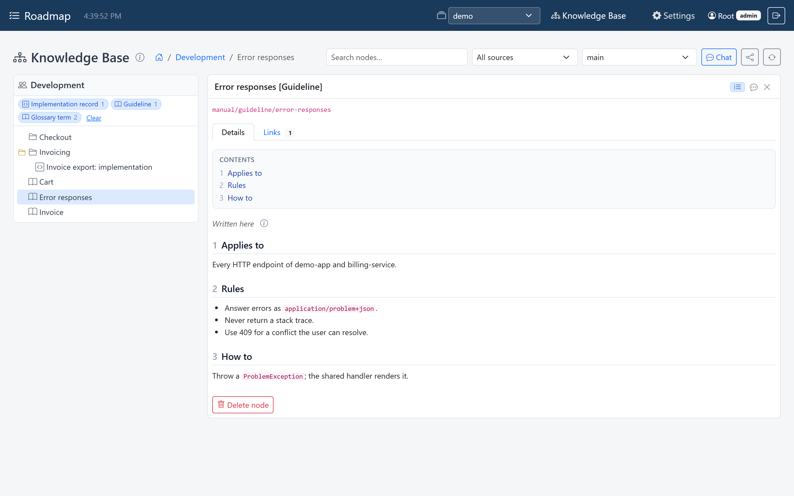
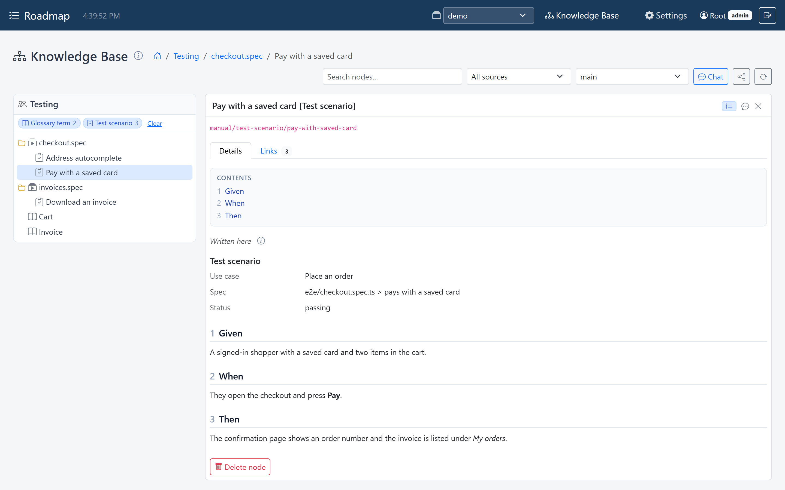
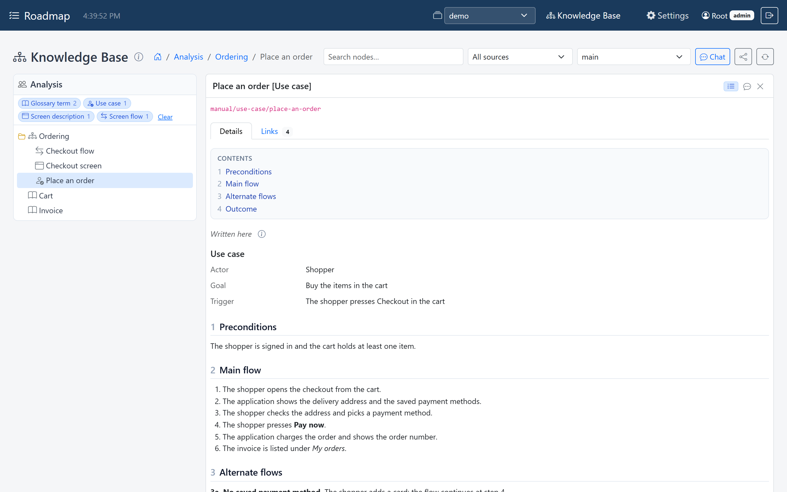
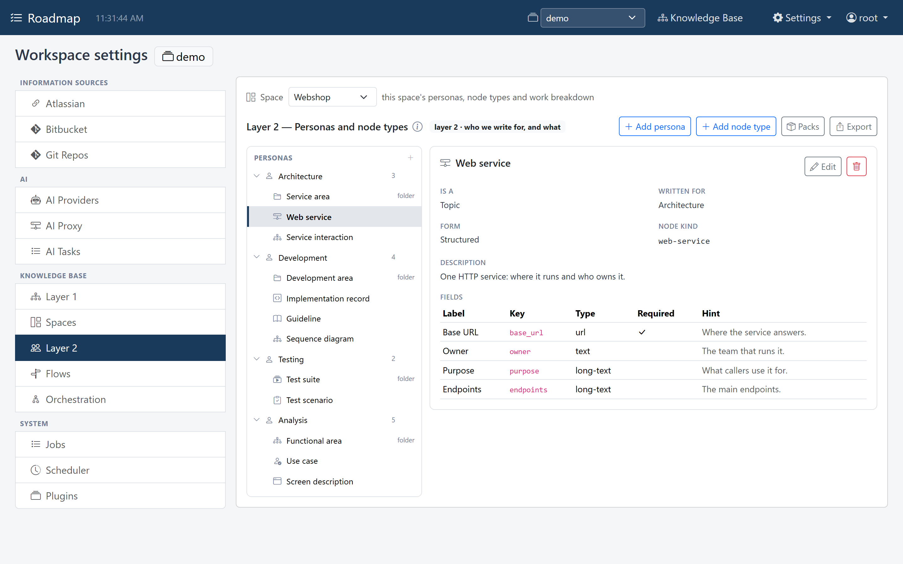
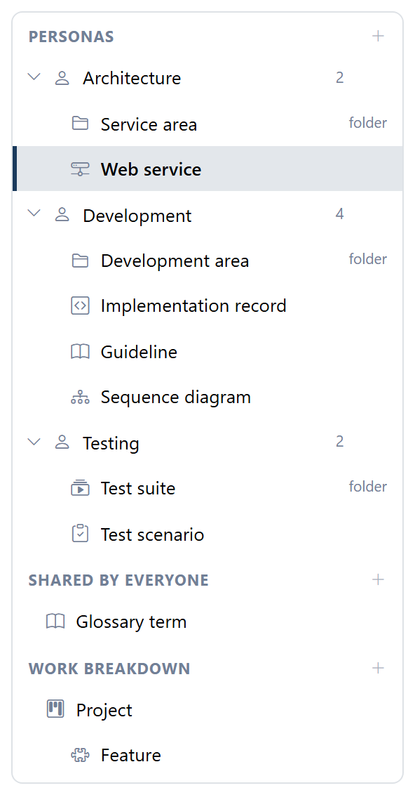
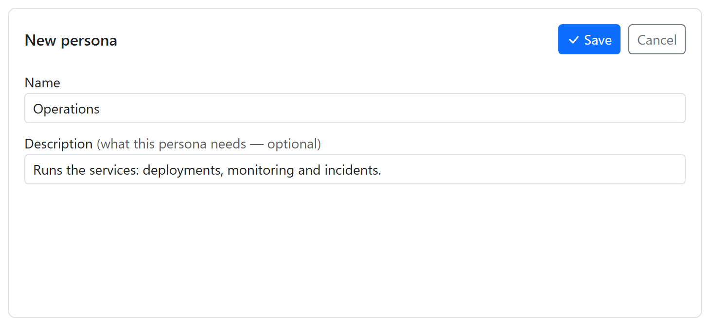

# Personas

A **persona** is who knowledge is written *for*: a role, such as *Architecture*,
*Testing* or *Business analysis*, or a specialism, such as *PrimeNG specialist*.
An architect and a tester need different pages out of the same ticket, so each
persona gets its own **lane** of [topics](topics.md).

The Knowledge Base page opens on the lanes: the work breakdown first, then one block
per persona, with its description and the top of its tree.



Opening a persona's block browses its lane: its tree of topics on the left, the
selected topic on the right (see [The explorer](explorer.md)). The same feature
reads differently in each lane:

=== "Architecture"

    The architect's view: services, their interfaces, and the decisions behind them.

    

=== "Development"

    The developer building the application: modules, guidelines, implementation
    records.

    

=== "Testing"

    The tester: test suites and the test scenarios in them.

    

=== "Analysis"

    The business analyst: what the application does, in terms that stay true
    whatever it's built with. Use cases, screens and screen flows.

    

The *Cart* and *Invoice* glossary terms appear in every lane: their type is shared
by everyone (see [Topics](topics.md#topic-types)).

## Set up personas

Personas are set up per workspace, under *Settings → Knowledge Base → Layer 2*, and
that needs the [admin role](../get-started/users.md#roles). To start from
ready-made personas and topic types instead, [install a pack](packs.md).



On the left is a tree in three groups:

- **Personas**, each with the number of topic types written for it. Expand one to see
  its folder and topic types.
- **Shared by everyone**: topic types with no persona; their topics appear in every
  lane.
- **Work breakdown**: the types of work, nested under their parent type.

{ width="296" }

Select a persona or a type to see it on the right, and click **Edit** to change it.

### Add a persona

Click **+ Add persona**, give it a **Name** and a **Description**, and click the
form's **Save**. That stores it straight away. A name that is already taken is
refused.

{ width="730" }

Write the description, even though it's optional: it tells people and AI agents
what belongs in that persona's lane, and an AI writing for the persona reads it.

A new persona gets an id made from its name (*Business analysis* becomes
`business-analysis`). Topics refer to the persona by that id, so renaming a persona
later keeps its lane. A new persona goes at the end, and the order of the personas
is the order of the lanes.

Then give the persona its [topic types](topics.md#topic-types).

### Remove a persona

Select it, click the trash button next to **Edit**, and confirm. That is stored
straight away. The topic types written for it become shared by everyone, so their
topics appear in every lane, and flows that wrote for it stop writing for it.

### Reorder personas

The settings screen can't reorder personas. To change the order of the lanes, stop
Roadmap, change the order of the `personas` list under `knowledgebase` in the
workspace's `config.yaml`, and start it again. Stop it first: saving in the settings
screen writes the whole file, and would undo an edit made while Roadmap runs.

```yaml
knowledgebase:
  personas:                # the order here is the order of the lanes
    - id: testing
      name: Testing
      description: What to test and how.
    - id: architecture
      name: Architecture
      description: Services, their interfaces and the decisions behind them.
```

The `default` workspace uses `config.yaml` itself; another workspace uses
`workspaces/<name>/config.yaml` next to it (see
[Workspaces](../get-started/workspaces.md#where-a-workspaces-files-are)).
