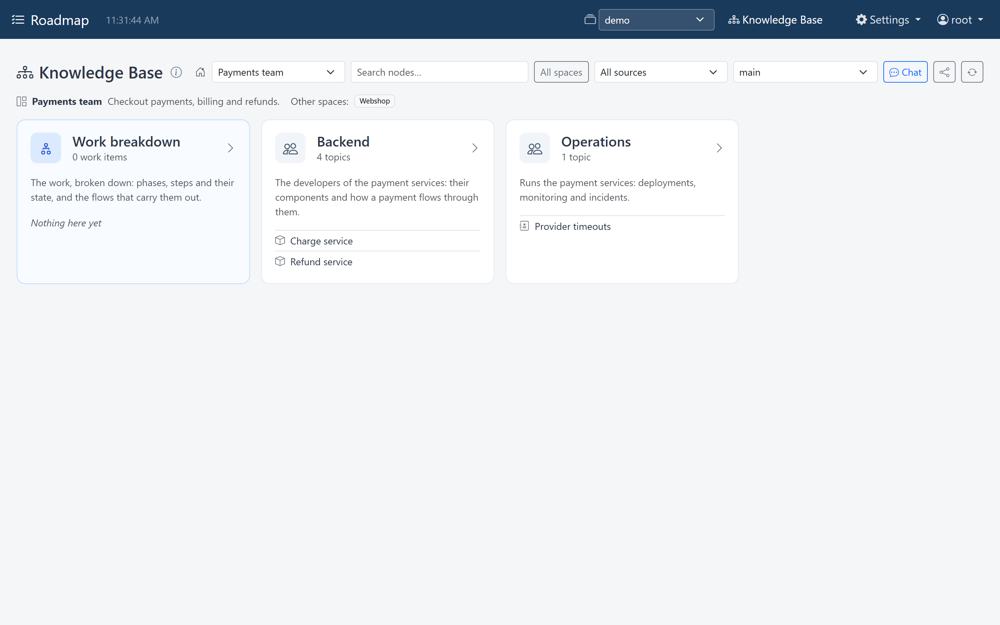
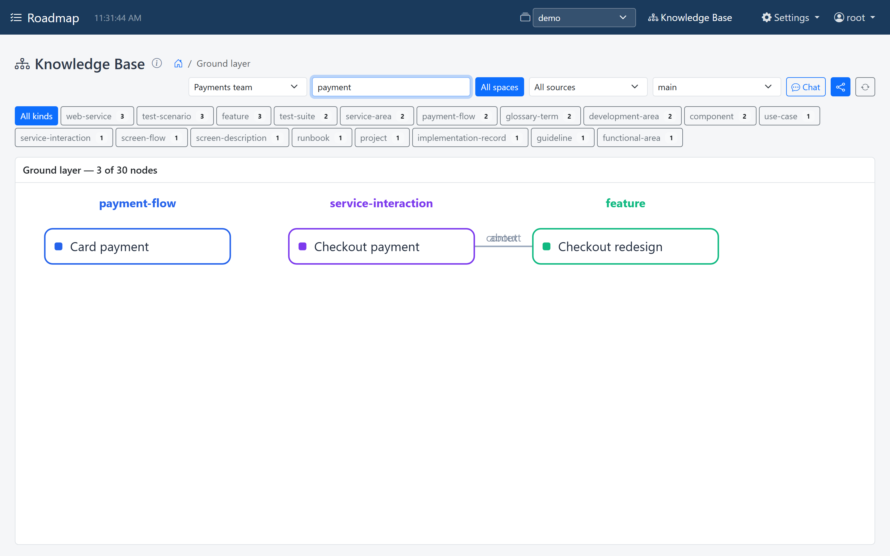
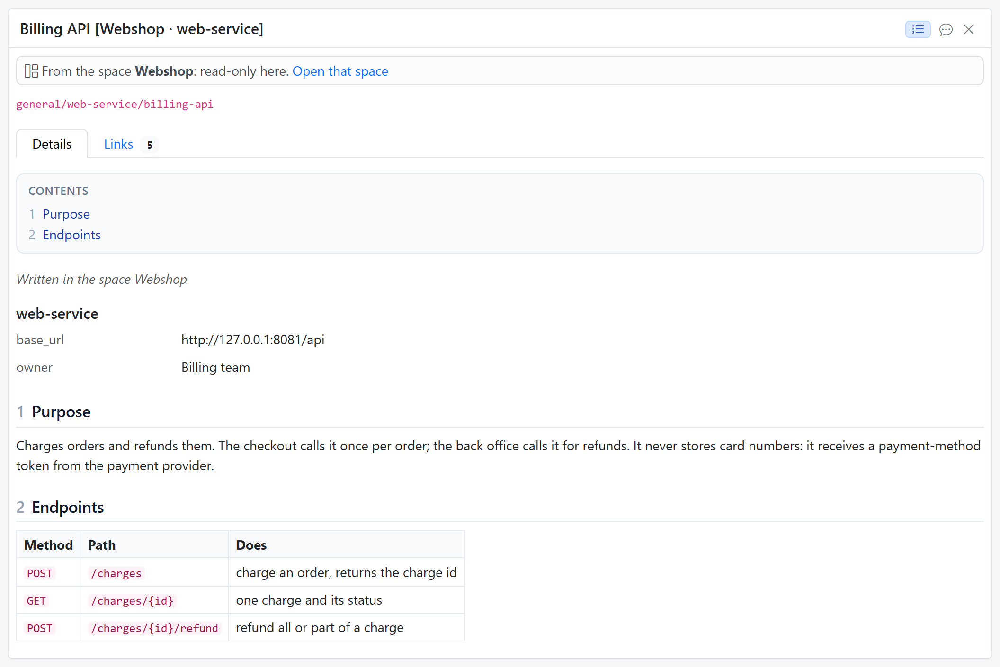
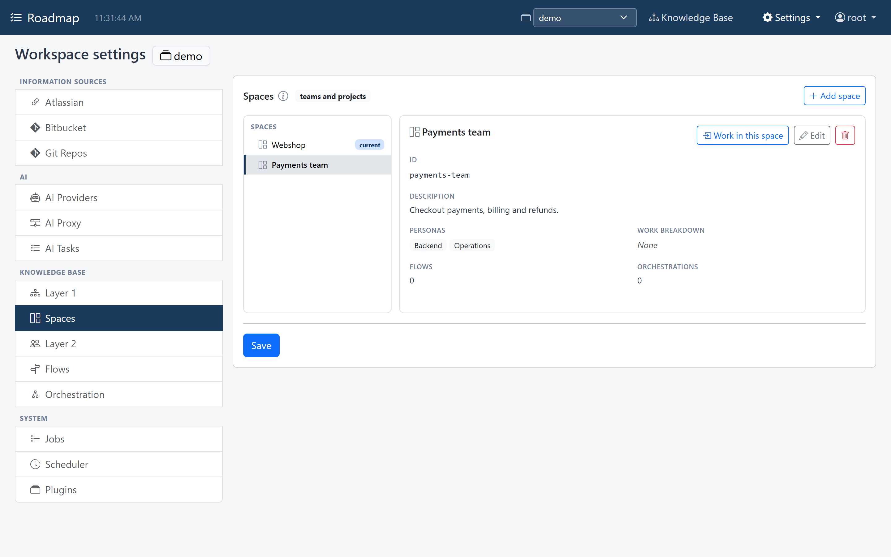
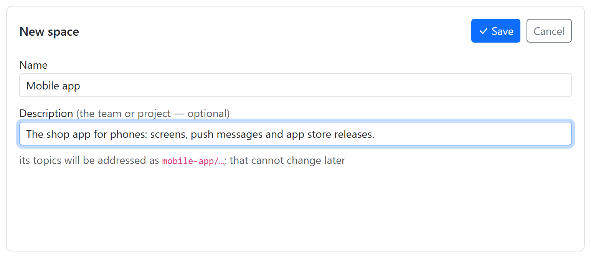
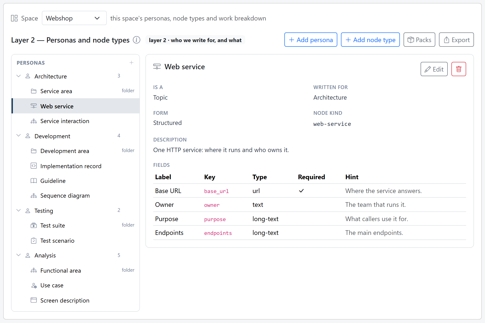
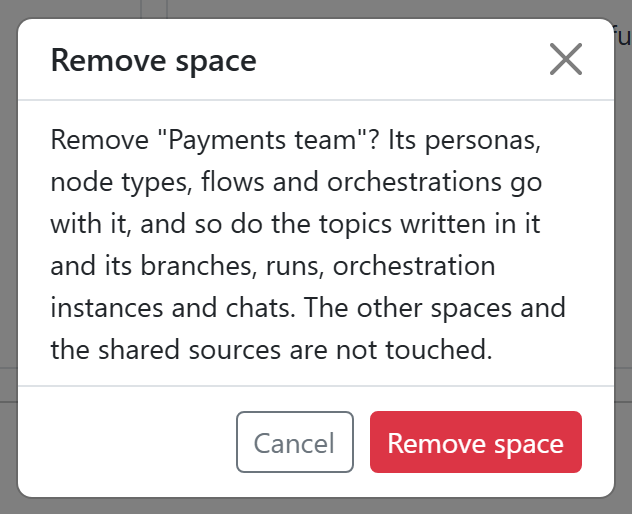

# Spaces

A **space** is one team's or one project's part of the Knowledge Base, the way a
team has its own board and its own people. Each space has its own
[personas](personas.md), its own [topic types](topics.md#topic-types) and work
breakdown, its own [flows](flows.md), [orchestrations](orchestration.md) and
[branches](branches.md), and the topics written in it.

What the teams have in common is shared by every space in the workspace: the
information sources, and the [ground layer](concepts.md) read from them. Every
team sees the same repositories, pages and tickets.

| Each space has its own | Shared by every space |
|---|---|
| personas and topic types | the information sources (*Layer 1*) |
| the work breakdown: projects, features, steps | the ground layer |
| flows and orchestrations | Git Repos, AI providers, the rest of *Workspace settings* |
| branches and chats | |
| the topics written in it | |

## Read across, write in your own

You read and write in one space at a time. The other spaces' topics can be read and
linked to, but not changed: a topic is written in the space it belongs to. A
topic's *Links* tab shows its links into other spaces, marked with the space, such as *in Webshop*,
even without *All spaces*, and opens the topic at the other end beside your lane. So the
payments team can link its design to the webshop team's use case, and only the
webshop team changes that use case.

## Spaces or workspaces?

Both separate teams, in different ways:

| | Workspaces | Spaces |
|---|---|---|
| What they are | separate tenants on one server | teams or projects inside one workspace |
| Sources and settings | each its own | shared |
| Seeing each other's knowledge | no | yes, read-only |
| Who sets them up | an admin, from the header | an admin, under *Workspace settings* |

Use [workspaces](../get-started/workspaces.md) when nothing should be shared, such
as two customers. Use spaces for teams that work on the same systems.

## The Knowledge Base page with spaces

With one space, the Knowledge Base page looks as before. Once there are two or
more:

- A **space picker** next to the search box switches the page to another space.
  The page reloads in it, the way switching workspace does, and the address carries
  the space as `?space=<id>`.
- The home page names the space you are in, with its description, and links to the
  **other spaces**.
- **All spaces**, next to the search box, adds the other spaces' topics to a
  search. They show in the ground layer graph.

    { width="558" }

    

- In the graph, the other spaces' topics are drawn with a dashed border.
- A topic of another space opens **read-only**: *From the space ...: read-only
  here*, with a link to **Open that space**. Its title names the space, and it says
  *Written in the space ...*.

    { width="1056" }

## Set up spaces

Spaces are set up under *Workspace settings → Knowledge Base → Spaces*, and that
needs the [admin role](../get-started/users.md#roles). On the left are the spaces,
with *current* next to the one you are in; on the right, the selected space: its id,
its description, its personas and work breakdown, and how many flows and
orchestrations it has.

### Add a space

Click **+ Add space**, give it a **Name**, such as *Payments team*, and a
**Description** of the team or project, and click **Save**. That stores it straight
away. A name already in use is refused: *There is already a space named "..."*.

A new space gets an id made from its name, shown under the form: *Payments team*
becomes `payments-team`. The id can't change later; renaming the space keeps it.

{ width="770" }

A new space starts empty. Give it personas and topic types, or
[install a pack](packs.md) in it.

### Work in a space

*Layer 2*, *Flows* and *Orchestration* edit the space you are in. Once there are two
or more spaces, a space picker at their top switches space. On the *Spaces* tab,
**Work in this space** does the same for the selected space.

{ width="1054" }

### Remove a space

Select it, click the trash button next to **Edit**, and confirm. Its personas, topic
types, flows and orchestrations go with it, and so do the topics written in it. The
other spaces and the shared sources are not touched. The last space can't be
removed.

{ width="316" }

## From before spaces

A Knowledge Base from before spaces becomes one space, **General** (id `general`),
the first time the new version starts. Everything it held is kept, in that space.
