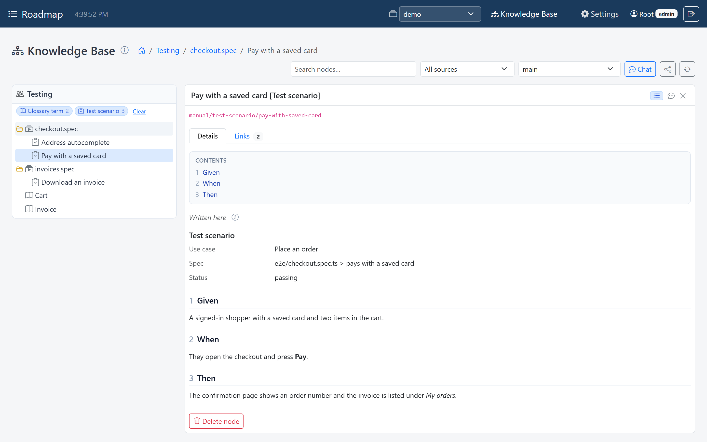
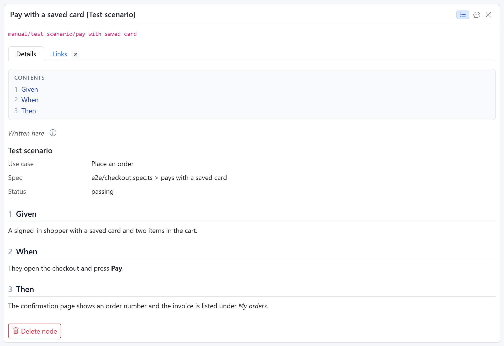
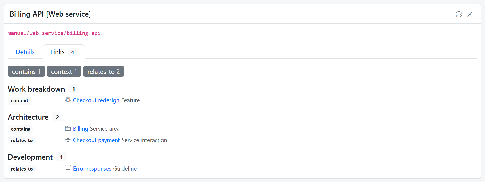
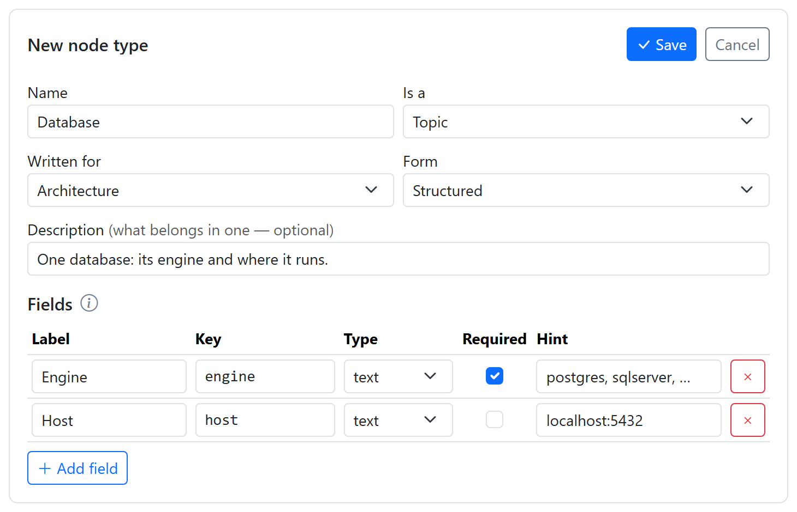
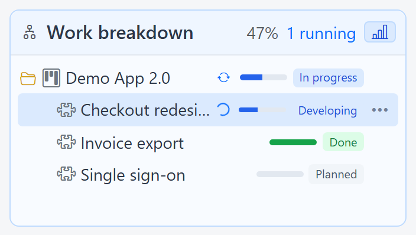

# Topics

A **topic** is one page of knowledge: a use case, a web service, a database, a
screen, a test scenario, a sequence diagram. Topics are written by AI agents,
through [flows](flows.md), for a [persona](personas.md), and people read them in the
[explorer](explorer.md).

## A topic up close

Selecting a topic opens it, titled with its name and its type in brackets, such as
*Pay with a saved card [Test scenario]*. The *Details* tab shows its short fields,
then its document: a table of contents and every section, with diagrams drawn.

{ width="1056" }

The *Links* tab shows how the topic relates to others, grouped by lane, with one
toggle per kind of relation. A link opens the topic at the other end.

{ width="1056" }

## Topic types

Every topic has a **type**, and the type says what a topic of it holds. Use one type
per kind of information: *Database* and *Web service* are two types, not one
"technical asset" type.

!!! tip "The type is the specification"
    When an AI writes a topic, the type's description, fields and template are what
    it's asked to fill in. A vague type description produces vague topics.

A type is one of three kinds:

| Kind | What it is | Lives in |
|---|---|---|
| **Topic** | the page somebody wants to read: a use case, a web service, a test scenario | a persona's lane |
| **Folder** | a group of topics, such as a *Service area* above its services; it can have content of its own, saying what the group is for | a persona's lane |
| **Unit of work** | a project, a feature, a step | the work breakdown |

A topic or folder type is written for one persona, or **shared by everyone**: a
*Glossary term*, for example, appears in every lane.

And it has one of two forms:

- **Structured**: a short list of fields, such as *Engine* and *Host* for a
  database. Every topic of the type answers the same questions, so they can be
  compared. A field can hold text, a number, a date, a link, or a diagram.
- **Unstructured**: free text, with an optional template, so the tenth test scenario
  has the same headings as the first.

## Add a topic type

Topic types are set up per workspace, next to the personas, under *Settings →
Knowledge Base → Layer 2*, and that needs the
[admin role](../get-started/users.md#roles). Click **+ Add node type**, or the **+**
next to *Shared by everyone* or *Work breakdown*:

{ width="730" }

| Field | What it is |
|---|---|
| Name | The type's name, such as *Database*. |
| Is a | *Topic*, *Folder* or *Unit of work*. |
| Written for | The persona, or *Everyone* for a shared type. For a unit of work this is **Under**: *Top level*, or the type of work it sits under. |
| Form | *Structured* (fields) or *Unstructured* (free text). |
| Description | What belongs in one. The AI writes to it, so be specific. |
| Fields | Structured types: **Add field**, then a Label, a Key, a Type, Required and a Hint for each. Leave the Key empty to have it made from the label when you save: *Primary actor* becomes `primary_actor`. |
| Template | Unstructured types: the text a new topic starts from. |
| Lifecycle | Units of work: **Add state** for each state, in order. Without any, it goes through *Planned*, *In progress*, *Done*. |

Click the form's **Save** to store the type straight away. The settings screen keeps
you to the rules: a unit of work, for instance, offers *Under* instead of *Written
for*.

## Change or remove a type

Select the type, click **Edit**, change it, and save. Changing a type doesn't
rewrite the topics already written: a field you remove stays in their content until
they are written again.

To remove a type, select it, click the trash button next to **Edit**, and confirm. A
type that topics still use can't be removed: delete those topics first.

## Units of work

Units of work make up the **work breakdown**: a project holds features, a feature
holds steps. Each has a state from its type's lifecycle and a progress bar, and a
spinner marks one that a flow is working on.

{ width="352" }

Progress rolls up: a feature with steps under it is as far along as its steps
together. A person moves an item one state at a time, forward or back; a flow or an
[orchestration](orchestration.md) moves it as the work goes on. Topics written while
working on an item are linked to it, so its *Links* tab answers "what do we know
about this?"
