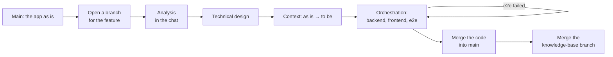

# Walkthrough: a feature end to end

This page follows one feature, **password reset** in a web app, from the first
question to the merge. It's based on a real run in which three AI sessions worked
together: one hosting a chat with a person, one developing the app, and one
looking after Roadmap. Every step uses the tools described elsewhere on this site.



## 1. Main describes the app as it is

The knowledge base already holds what earlier [flows](flows.md) wrote about the
app: use cases and screens for the business analyst, components and endpoints for
the architect, and so on, each persona in its own lane. The work breakdown holds
the project and its features.

## 2. Open a branch from the chat

A person opens a [chat](chat.md) in the explorer and pastes its MCP instruction
into an AI console. They say they want users to be able to reset a forgotten
password. The AI adds a *Password reset* feature to the work breakdown and opens a
branch for it, tied to the chat:

```
kb_branch("open", name="password-reset", work_item="manual/feature/password-reset",
          chat="kbc-m9udq8", git_branch="feature/password-reset")
```

From now on, everything the chat shows is read in the branch, and everything the AI
writes goes into it. Main doesn't change.

## 3. Analysis and design in the branch

In conversation with the person, the AI writes the analysis: a use case with its
flows, a screen sketch of the *Forgot password* and *Reset password* pages
([wireframes](documents.md#wireframes)), and the rules (how long a link is valid,
what happens on a second request). Asked for a technical design, it adds the
backend and frontend design topics: the new endpoints, the token table, the
sequence of calls.

In the explorer, the branch bar shows what changed. **Changes only** narrows the
lanes to the new and changed topics, and each topic's **Changes** tab shows its
diff and its diagrams side by side, as is and to be. Main still shows the app
without the feature.

## 4. Hand the context to the developer

The developer is a separate AI session working in the app's repository. It gets
the branch's [context](branches.md#context-for-the-developer), filtered to the
personas it works for:

```
kb_branch("context", id="password-reset", personas="analysis,architecture,backend")
```

That's the feature as **as is → to be**: new topics in full, changed topics as
diffs against main. It's exactly the instruction a developer needs, and nothing
the feature doesn't touch.

## 5. Build it with an orchestration

An [orchestration](orchestration.md) runs the delivery in the branch: backend,
frontend, end-to-end tests, release. The developer loops on
`kb_orchestrate("next")`, does each step in the feature's git branch, and finishes
each run with the commit it made:

```
kb_flow("finish", id="<run>", outcome="ok", commit="4f2a9c1")
```

Each commit is recorded on the knowledge-base branch, so the branch bar shows how
far the code has come. When the end-to-end tests fail, the run finishes `failed`
with what broke, and the machine sends the feature back to development, with the
failure message as the starting point for the next run.

The end-to-end tests themselves became knowledge: a *Testing* persona with test
suites and test scenarios, written in a branch of their own and merged first.

## 6. Merge the code, then the knowledge

When every step is done and the tests pass, the release step merges the git branch
into the app's main line. Only then does the final state merge the knowledge-base
branch:

```
kb_branch("merge", id="password-reset")
```

The merge is refused while the feature's work item isn't finished, or while main
changed a topic the branch changed too. In the real run, the branch merged
cleanly: 23 topics added, 5 changed, 4 commits recorded, and the feature at
*Done*. Main now describes the app **with** password reset, from the moment the
code has it.
