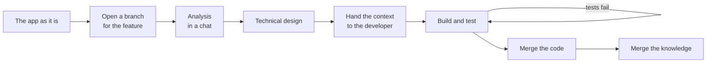
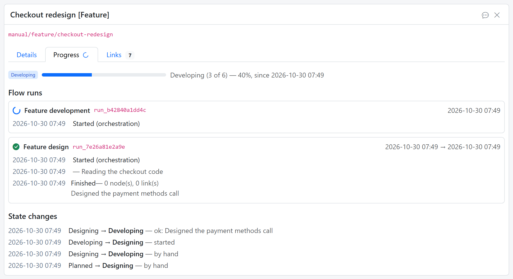

# Scenario: implement a simple use case

This scenario follows one use case, **reset a forgotten password** in a web app, from
the first question to the moment the knowledge base describes it as built. Three AI
sessions take part: one chatting with a person, one developing the app, and the
Knowledge Base keeping track of both.

## 1. The knowledge base describes the app as it is

Earlier [flows](flows.md) have written what is known about the app: use cases and
screens for the business analyst, services and endpoints for the architect, test
scenarios for the tester, each [persona](personas.md) in its own lane. The work
breakdown holds the project and its features.

## 2. Ask for the feature in a chat

A person opens a [chat](chat.md) from the explorer and connects an AI to it. They
explain that users should be able to reset a forgotten password. The AI adds a
*Password reset* feature to the work breakdown and opens a [branch](branches.md)
for it. From now on, everything the AI writes about the feature goes into that
branch, and the main knowledge doesn't change.

## 3. Analysis and design

In conversation with the person, the AI writes the analysis as [topics](topics.md):
the use case with its main and alternative flows, a sketch of the *Forgot password*
and *Reset password* screens, and the rules, such as how long a reset link stays
valid. Asked for a technical design, it adds the new endpoints, the table that keeps
the reset tokens, and a sequence diagram of the calls.

In the explorer, the branch bar shows what the branch changes. **Changes only**
narrows the lanes to the new and changed topics, and each topic's **Changes** tab
shows it as is and to be, side by side.

## 4. Hand the context to the developer

The developer is another AI session, working in the app's repository. From the
branch's **Context** panel, the person picks the personas the developer works for
and copies the instruction for it. The developer then reads the feature as **as is →
to be**: the new topics in full, and the changed topics as differences. That's
exactly what it needs to build the feature, and nothing the feature doesn't touch.

{ width="1382" }

## 5. Build and test it

An [orchestration](orchestration.md) takes the feature through development and
testing: backend, frontend, end-to-end tests. The developer works through each step
in the feature's git branch, and the work breakdown shows where the feature is. When
the end-to-end tests fail, the orchestration sends the feature back to development,
with what broke as the starting point for the next attempt.

{ width="1056" }

The end-to-end tests become knowledge too: test scenarios for the *Testing* persona.

## 6. Merge the code, then the knowledge

When the tests pass, the code is merged into the app's main line. Only then is the
knowledge base's branch merged, so the knowledge base never describes code that
isn't there yet. The merge is refused while the feature isn't finished.

From that moment, the knowledge base describes the app **with** password reset, and
the next feature starts from there.
