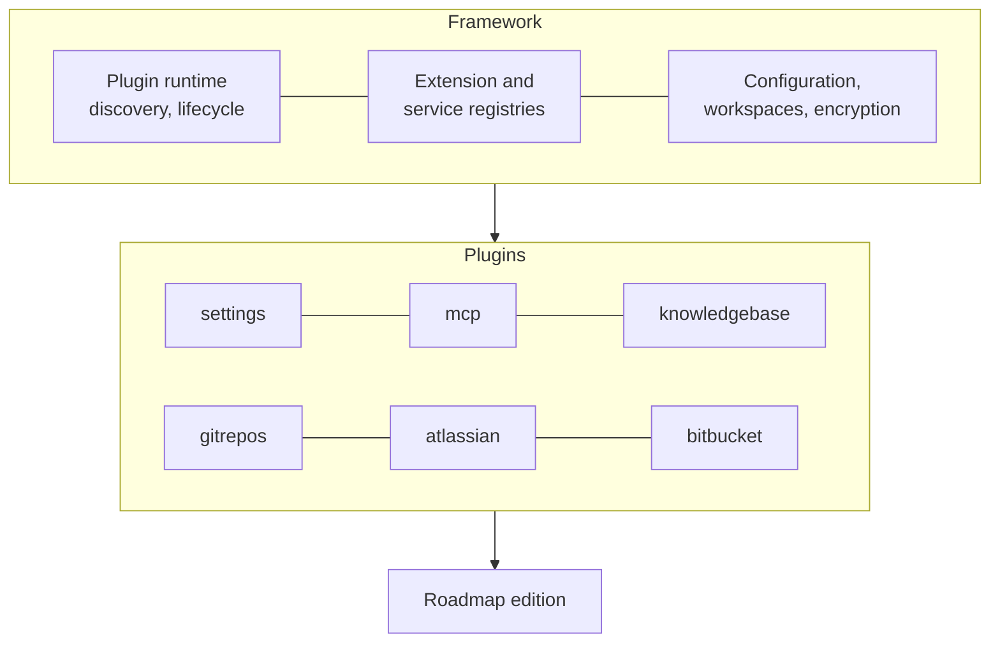

# The platform

Roadmap is built on a **plugin framework**. Everything you use, from the Knowledge
Base to the MCP server and every information source, is a plugin; the framework underneath
discovers the installed plugins, starts them in the order their dependencies need,
and gives them a shared configuration, settings screens, encryption and workspaces.
An **edition** is the framework plus the plugins it bundles.

## The plugin model

- A **plugin** is a Python package the framework discovers at startup. It says which
  other plugins it requires, and the framework activates them in that order.
- A plugin can **declare extension points** and **contribute extensions** to points
  declared elsewhere. The flow runner, for example, declares the readers a flow can
  read its source with, and every plugin registers its tools on the MCP server.
- A few plugins are **core**: always on, and they can't be uninstalled. In Pro those
  are Settings and the MCP server.
- The **frontend** mirrors this: each plugin adds its own pages, settings tabs and
  item types to the app.
- Plugins are **enabled per workspace**: one server serves several teams, each with
  its own configuration and data. See [Plugins](../get-started/pro.md#plugins) for
  the screens that manage them.

## Plugins per edition

### Pro

Bundled: installed and enabled in every Pro install. The ids are the ones the
registry and *Settings → System → Admin* show.

| Plugin | What it adds |
|---|---|
| `roadmap.knowledgebase` | The Knowledge Base: the ground-truth graph (Layer 1), topics per persona (Layer 2) defined by node types and [packs](../knowledge-base/packs.md), flows, orchestrations and branches; its page, its settings, and the `kb_*` MCP tools |
| `roadmap.knowledgebase.flows` | Runs Knowledge Base [flows](../knowledge-base/flows.md) on the server with your AI provider. Without it, flows are handed out as briefs for an external AI to carry out |
| `roadmap.mcp` | The MCP server, which every plugin registers its tools on: SSE at `/mcp/sse` and stateless HTTP at `/mcp` (see [Two endpoints](../reference/mcp-tools.md#two-endpoints)). Core |
| `roadmap.gitrepos` | [Git Repos](../get-started/git.md): the local working copies flows read |
| `roadmap.atlassian` | The Jira and Confluence connection, under *Information Sources*, offered as a Layer 1 source. Jira issue and Confluence page nodes can be opened and refreshed through it, which pulls their title and an excerpt |
| `roadmap.bitbucket` | The Bitbucket connection, under *Information Sources*, offered as a Layer 1 source. Its nodes are pointers, as an agent or a flow wrote them |
| `roadmap.ai` | The AI providers |
| `roadmap.jobs` | Background jobs with a status and a log, such as flow runs, shown under *Settings → System → Jobs* |
| `roadmap.scheduler` | Scheduled tasks |
| `roadmap.settings` | The settings screens. Core |
| `roadmap.folderpicker` | The folder dialogs behind *Browse* and *Import* in Git Repos, for a single-user install on a desktop; on a server, type paths instead |

Roadmap doesn't sync or crawl any source: Layer 1 nodes are written by agents and
flows. Only Atlassian nodes can be opened and refreshed from Roadmap.

Extra: in the registry, installed from *Settings → System → Admin*.

| Plugin | What it adds |
|---|---|
| `roadmap.trello` | The Trello connection and its boards, under *Information Sources*, offered as a Layer 1 source. Its nodes are pointers, as an agent or a flow wrote them |

### Lite

To be released soon.
