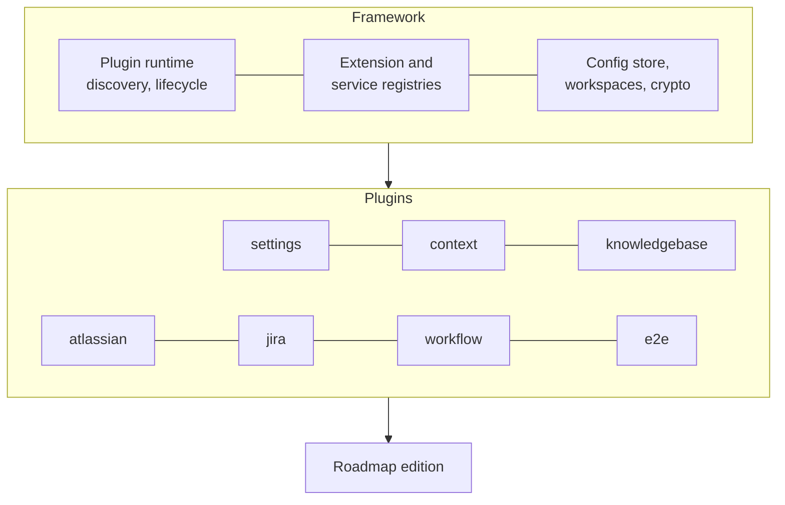

# The platform

Roadmap is a set of **editions** on a shared, OSGi-style **plugin** framework.
Functionality ships as plugins discovered at runtime; an edition is the framework
plus whichever plugins it installs. The app itself is a thin composition root with
no feature code of its own.

## The plugin model

- A **plugin** is a Python package with a `Plugin` activator, found through the
  `roadmap.plugins` entry point. The framework discovers every installed plugin,
  sorts them by what they require, and activates each one.
- A plugin **declares extension points** (the context plugin declares the context
  item types) and **contributes extensions** to points declared elsewhere (the Jira
  plugin contributes a Jira issue item type and a settings section).
- The **frontend** mirrors this: each plugin ships an Angular module that registers
  its pages, settings tabs and item types into the framework's registries.
- Plugins are **enabled per workspace**: one server serves several teams, each with
  its own configuration and data.

## Plugins

| Area | Plugins |
|---|---|
| Contexts | `context`, `jira`, `bitbucket`, `trello`, `context-assistant` |
| Knowledge | `knowledgebase`, `knowledgebase-flows` |
| Sources | `atlassian`, `gitmining` |
| Automation | `workflow`, `workflow-assistant`, `workflow-sql`, `workflow-activemq`, `jobs`, `scheduler` |
| Testing | `e2e`, `e2e-selenium`, `e2e-assistant` |
| Design | `mockup` |
| Viewers | `fileviewer`, `viewer-plantuml`, `viewer-markdown`, `viewer-image`, `gitdiff` |
| Shared | `settings`, `ai`, `whisper`, `folderpicker`, `scratchdir` |

More pages on the platform will follow. The Knowledge Base is documented first.
