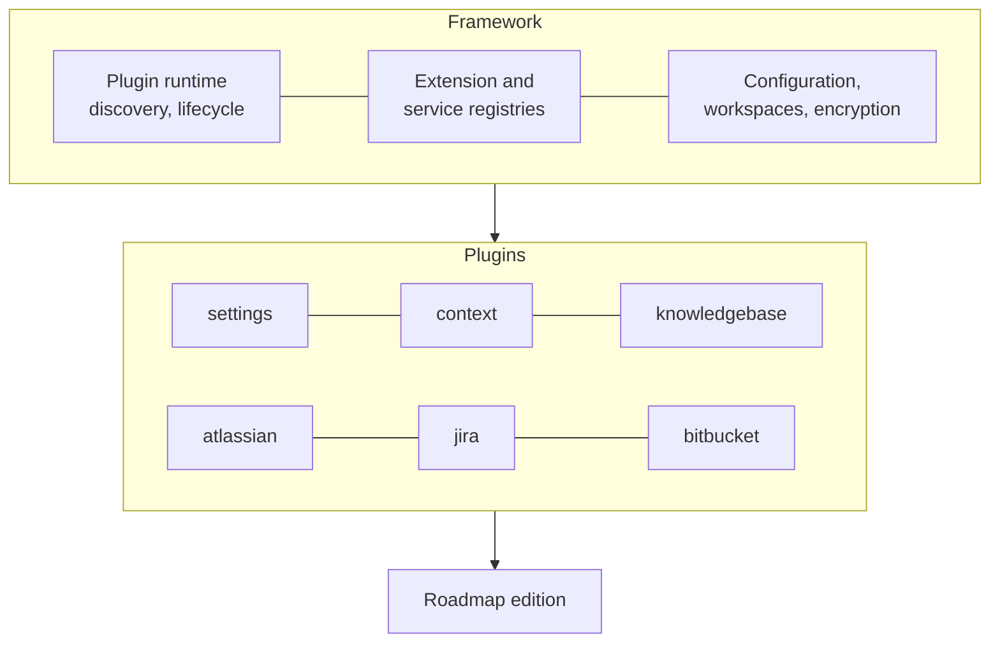

# The platform

Roadmap is built on a **plugin framework**. Everything you use, from contexts to the
Knowledge Base and every information source, is a plugin; the framework underneath
discovers the installed plugins, starts them in the order their dependencies need,
and gives them a shared configuration, settings screens, encryption and workspaces.
An **edition** is the framework plus the plugins it bundles.

## The plugin model

- A **plugin** is a Python package the framework discovers at startup. It says which
  other plugins it requires, and the framework activates them in that order.
- A plugin can **declare extension points** and **contribute extensions** to points
  declared elsewhere. The context plugin, for example, declares the kinds of item a
  context can hold, and the Jira plugin contributes a Jira issue item and a settings
  tab.
- The **frontend** mirrors this: each plugin adds its own pages, settings tabs and
  item types to the app.
- Plugins are **enabled per workspace**: one server serves several teams, each with
  its own configuration and data. See [Plugins](../get-started/pro.md#plugins) for
  the screens that manage them.

## Plugins per edition

### Pro

Bundled: installed and enabled in every Pro install.

| Plugin | What it adds |
|---|---|
| `knowledgebase` | The Knowledge Base: its store, the explorer, and the `kb_*` MCP tools |
| `knowledgebase-flows` | Runs Knowledge Base [flows](../knowledge-base/flows.md) on the server with your AI provider. Without it, flows are handed out as briefs for an external AI to carry out |
| `context` | Contexts, [Git Repos](../get-started/git.md), and the MCP server |
| `atlassian` | The Jira and Confluence connection (settings, client, cache) the other plugins use |
| `jira` | Jira issues and Confluence pages as context items, with previews and MCP tools |
| `bitbucket` | Bitbucket pull requests as context items |
| `ai` | The AI providers |
| `jobs` | Background jobs with a status and a log, such as flow runs |
| `scheduler` | Scheduled tasks |
| `settings` | The settings screens |
| `folderpicker` | The folder dialogs behind *Browse* and *Import* on a desktop |

Extra: in the registry, installed from *Settings → System → Admin*.

| Plugin | What it adds |
|---|---|
| `trello` | Trello cards as context items, with configured boards and three MCP tools |

### Lite

To be released soon.
